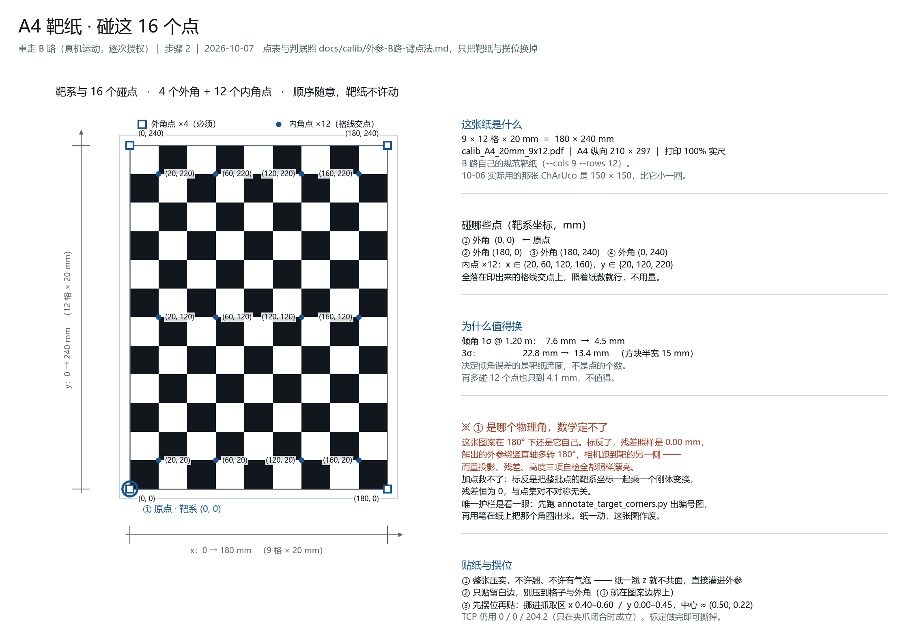

# 待执行命令清单（**只放还没做的**）

> **层级**：意图 · 这份是**队列**，不是文档。做完一条就删一条，正文进留档。
> 「这台系统现在什么样」见 [`当前状态.md`](当前状态.md)。

> **找命令只看这份。** 打开就是一屏，每条只有三样东西：**为什么 / 敲什么 / 怎么算通过**。
>
> - 做完一条 → **把它从这份里删掉**，把执行记录写进
>   [`待执行命令-留档.md`](待执行命令-留档.md)。
> - 要查「当时为什么这么定、踩过什么坑」→ **也去留档**（甲-1 … 甲-36 的原始正文全在那）。
> - 内容多了就再拆一次。**这份文件超过两屏，就是该收拾了** —— 2026-10-08 收拾过一次，
>   把**已了结**的章节整体搬进了留档（见该文件末尾的「附」，正文一字未改）。
>   **行数上限由 `scripts/test_doc_budget.py` 看着**（红着的守卫会挡提交）。
>   ⚠️ 它现在仍装着 A1 的现场 runbook 和几个悬案，离两屏还有距离 —— 分拆待定。
>
> ⚠️ **别把密码贴给对话，也别写进本仓库任何文件**（sudo 提示时在终端里直接输）。
> 凭据只放本机未跟踪位置 —— 见 [`JETSON_SSH.md`](JETSON_SSH.md)。

**连板子**（走 `~/.ssh/config` 的别名，**别手拼地址** —— 裸地址不带钥匙，会 `Permission denied`）：

```bash
ssh jetson-wifi                 # 无线。认亲：cat /proc/device-tree/serial-number → <board-serial>
```

> 有线那条 `<ip>` **已经没了** —— 那根网线拔去接控制箱了。

---

## 🟢 腕部视觉路线：手眼 TF → 腕部 RealSense → 现有 pipeline（2026-10-25）

**为什么**：腕部相机已经是事实上的视觉入口（10-24 两轮 3/3 抓起放下），但起法
散在仓库外（`~/handeye_ws/scripts/publish_on.sh` + 手工 `static_transform_publisher`）。
这一节把三个开关收进仓库。**本节的命令只验链路：`skip_planner:=true`，不发任何
运动目标、不碰夹爪。**

**敲什么**（板上；先看清动哪一份检出 —— 板上有**两份**）：

```bash
ssh jetson-hotspot
cd ~/yolo_ros_original && git status -sb && git log --oneline -1
python3 scripts/wrist_tf_publish.py --check      # 只验标定文件，不碰 ROS
```

```bash
# 终端 0（**先做**）：10-24 标定会话遗留的旧发布器还在跑（`~/handeye_ws` 的
# easy_handeye2），发的正是同一对帧。不停它，`camera_link` 会有**两个父节点**。
pgrep -af "handeye_publisher|publish.launch"          # 有输出 = 还在跑
pkill -f "easy_handeye2 publish.launch.py"; sleep 2
pgrep -af handeye_publisher || echo "旧发布器已停"
```

```bash
# 终端 A：发静态 TF `tool0 → camera_link`（前台常驻；标定换了要重启）
./docs/board/publish_on.sh
```

```bash
# 终端 B：腕部相机 + 检测 + 投影；**不起规划器**
export ROS_DOMAIN_ID=99
source /opt/ros/humble/setup.bash && source ros2_ws/install/setup.bash
ros2 launch yolo_bringup pipeline.launch.py camera_source:=realsense \
    realsense_params_file:=$HOME/.config/ur5-vision-grasp/wrist_camera.yaml \
    publish_camera_tf:=false skip_planner:=true \
    use_target_plane:=true target_plane_z:=0.0285 \
    grasp_point_mode:=top_face_center table_plane_z:=0.0
```

**怎么算通过**（三条都要）：

1. `python3 scripts/wrist_tf_publish.py --check` 退 **0**；
2. `python3 scripts/wrist_tf_publish.py --verify` 退 **0** —— 它直查 TF（不经过任何
   标定服务），逐项比对存盘的 `t/q`，并确认 `base_link → camera_color_optical_frame`
   可达；
3. `ros2 topic echo --once /targets_3d` 有候选（腕部视野里要摆着方块）。

⚠️ `publish_camera_tf:=false` 是**必须**的：腕部路线的 TF 由终端 A 发；两边都发会给
`camera_link` 两个父节点，TF 树时对时错。
⚠️ 参数文件里 `serial_no` 必须是**相机外壳标签上的 SDK 号**且**带引号**（模板
`ros2_ws/src/yolo_bringup/config/realsense_wrist.yaml`）。手敲 `ros2 launch` 时写
`$HOME`；走 `board_run` 时写 `~` 会被它展开。
⚠️ 腕部相机必须插 **USB3**：`cat /sys/bus/usb/devices/*/speed` 有 `5000` 才是；
`480` 时「能起节点但 0 帧」。

---

## 🟢 真机抓取测试（2026-10-08）—— 要你动的只剩**摆件**

**为什么**：要用启动器跑一次真机抓取、看抓得准不准（第一百二十七轮）。
启动器本身已 `--dry-run` 验过：**计划立得住**（PASS 7 / FAIL 0）。

**2026-10-08 起变化**（第一百二十八轮）：原来有**两件**要你单独跑，现在只剩**一件** ——
①（夹爪初始化）启动器改成**支持 AI 驱动**了，AI 能跑，你只要**在示教器上按提示动手**；
③（孤儿进程）`--stop` 改成**按会话收**，跑一次就干净。真正只有你能做的是一件事：
**② 往抓取区摆够方块**。

### ① 夹爪初始化：**AI 现在能跑了**（要你在示教器上补一次 STOP → PLAY）

~~启动器按设计拒绝非交互终端~~ —— 那是**旧版**（第一百二十七轮的现场门）。
2026-10-08 改掉了：`judge_write_path()` 不再「非交互即拒」（那是**缺陷**，
它把 AI 驱动整条路堵死）。现在按**有没有交互终端**分两档，都要人动手：

| 谁跑 | 授权怎么证明 |
|---|---|
| 人手动（终端里敲） | 敲一次 `yes`（原样） |
| **AI 驱动（后台，无 TTY）** | **不敲键盘** —— 示教器上 **STOP → PLAY 两步握手**，只读核验 |

AI 那一档的提示会压成一行 `>>> 需要人动手 …` 印出来，**由 AI 原样转达给你**；
它只会**等**（轮询只读 Dashboard），等不到就**退 2**（一个寄存器都不写）。

> ⚠️ **板上得先有这一轮的代码**：改动在 `scripts/` 与 `docs/`（**只有 `ros2_ws/`
> 才要 `colcon build`**，`scripts/` / `config/` 拷过去即生效）。且板子上有**两份**
> 检出（`ur5-vision-grasp` 与 `yolo_ros_original`）—— **动哪一份先看清**
> （`git -C <目录> status -sb` + `git log --oneline -1`），别把两边搞混。

```bash
ssh jetson-wifi
cd ~/yolo_ros_original && . /opt/ros/humble/setup.bash && . ros2_ws/install/setup.bash
python3 scripts/board_run.py --task a1 --init-gripper          # 人来跑的那一档
```

**怎么算通过**：先把**完整报文**摆出来（哪些寄存器、走多少行程），
然后 —— 人手动 ⇒ 敲一次 `yes`；AI 驱动 ⇒ 按提示在示教器上 **STOP → PLAY**。
之后 `P1.AG-95 初始化` 那一项下一次跑时应为 PASS。
（⚠️ 判据别只看 `close()` 的返回值 —— 见 `ag95-uninitialized-silent-false-success`，
未初始化时它照样报成功。以 `0x0200` 的读数为准。）

### ② 抓取区摆够方块：**≥5 块**

`config/tasks/a1.yaml:72` 的 `min_candidates: 4`，同处注释写明
「抓取区里要摆 **≥5 块**（= 槽位 4 + 1）」。现在台面上**只有 1 块**
（黄方块，`base=(0.485, 0.301, 0.028)` —— 在抓取区内，但不够数）。

抓取区：`pick_zone = x∈[0.4, 0.6], y∈[0, 0.45], z∈[0, 0.0485]`
（读自 `planner_params_file`）。

**怎么算通过**：只相机起栈后 `/targets_3d` 的候选数 ≥4
（少一个就直接 `[FAIL] 只有 N 个候选 < 要求 4 个`，`board_gate.py:236`）。


---

## 🟢 本仓公开：建 GitHub 远端并首推（阶段 0 的最后一步）

**为什么**：仓库已经建好、历史已脱敏，缺的只是远端 —— 本机**没有 `gh`**，
所以远端要你手动建一次。

**敲什么**（在 `~/robotics/repos/ur5-vision-grasp` 里）：

```bash
python3 scripts/test_deidentified.py    # 推之前先跑，必须 0 命中

# 在 GitHub 网页建一个**空**仓库（不要勾 README / .gitignore / LICENSE），然后：
git remote add origin git@github.com:<你的账号>/ur5-vision-grasp.git
git push -u origin migrate/humble-orin:main
```

**怎么算通过**：`git ls-remote --heads origin` 列出 `refs/heads/main`，
且网页上看到的是 **336 条提交**（不是一条孤零零的 initial commit）。

⚠️ 推上去那一刻就是**公开**了 —— 事后删除会留在别人的 fork 与缓存里。
所以**先把仓名和 LICENSE 定死**（当前 LICENSE 是 MIT）再推。
⚠️ 别 `--force`。也别把本地的 `main` 分支推上去 —— 那是旧教材项目的 7 条提交
（落后 329 条）；要公开的是 `migrate/humble-orin` 这条线。
⚠️ `block_best.pt` **不在仓库里**（6 MB，按规范走外链）。发布前给它一个公开地址，
填进 `README.md` 的「模型权重」一节 —— 那一节现在写着「外链地址：待补」。

---

## 🟢 A1 · 真机「抓 4 放 4 + 槽位用尽收工」

> 🔴 **正文搬到了 [`A1现场runbook.md`](A1现场runbook.md)**（2026-10-08）。
> 那是全仓**唯一权威**的「真机启动序列」：起栈 → 按 PLAY → 拉回控制器 →
> 预检四项 → 摆件 → 收工判据。由 `scripts/test_startup_docs.py` 把它三处命令块的
> 参数集与 `scripts/board_a1.py::build_cmd()` 逐项对。
>
> **别在这里重写一份。** 参数集分开 = 两份会烂的真值，两边迟早说不一样的话。
> 搬走的原因：390 行，把这份队列顶得离它自己写的「两屏」很远。

---
## 🟢 统一启动器：板端阶梯验证（R0 无运动 ×3 / R1 有运动 ×1–2）

**为什么只有你能做。** 这一轮把「启动这条路」从**判断**变成**计算**：
`scripts/board_run.py` 读 `config/tasks/<任务>.yaml`，一条命令走 P0 自检 → P1 前置 →
P2 起栈 → P3 等人按 PLAY + 控制器闸门 → P4 起栈后预检 → P5 交棒判分。
**但离线层只验了「判定逻辑对合成事实的反应」**：相机外参、夹爪 `0x0200`、
控制柜 `robotmode`、控制器**实际**状态，离线全是 SKIP —— **设备一件都没验过**。
下面的阶梯是唯一能证明它真能用的东西。

⚠️ **每一档都属红线 6 —— R0 也是**（2026-10-06 更正）：当次授权 ＋ 急停在手边 ＋
工作区隔离。**上一次的授权不覆盖这一次。** 启动器**永不**发 play/power/stop ——
示教器上的 PLAY 由人按（决策 5）。

> **为什么 R0 也算。** 它 `skip_planner:=true`，确实**不发**任何目标点；但它**照常起栈**
> —— UR 驱动与 URCap 照常连接，launch 照常把 `scaled_joint_trajectory_controller` 等
> 控制器**激活**（R0 第 3 次实测 `P3.controllers`：2 个控制器 `active` 且稳定 8.0 s）。
> 臂已上电、指挥权在栈手上 ⇒ 按红线 6 的措辞（「**控制器切换**」那一类）就是高风险操作。
> 本文件先前只把 R1 标成红线 6，**是把 R0 简化过头了**。

### 第 0 步：先看清它这一轮会发什么（**在桌面上就能做**）

```
python3 scripts/board_run.py --help
python3 scripts/board_run.py --task a1-noplan --site ~/.config/ur5-vision-grasp/site.yaml --dry-run
```

`--dry-run` **一个子进程都不跑**（有哨兵文件证明），只把**真实会发的参数集**
摆出来。对着任务描述与权威序列（[`A1现场runbook.md`](A1现场runbook.md)）核一遍再往下走。

⚠️ 但 **`--dry-run` 里的绿不是验收**：它上面每一项都标着「**声明缺席**」，
报告末尾也自己写着这句。它现在**多做了一件**真的检查 —— `P2.槽位数`
（只读一个文件，不跑子进程、不连设备，在合同之内）：任务描述期望几个槽、
`planner_params_file` 里实际几个槽，**不一致就当场退 2**。这一项以前只在上板起栈
那一刻才暴露，形态是「跑完一整轮才发现判错了」。

### 第 0 步半：**板上实测**到哪一步了（2026-10-06，`--attach` 只读跑）

`--attach` 是**零副作用**通道：跑 P0+P1（都只读），再拿**已经起着**的栈做 P3/P4
—— 不动臂、不切控制器、不起栈。但 P2 那一关要一份日志才放行（判分要读它），
所以**栈没起过时**它会停在 `P2.起栈`，报「**没有栈可附着**」—— 那一条是**预期的**，
不是缺陷。想让它走到底，就把它指到起栈那个人手里的日志：`--log <那份日志>`。

```
python3 scripts/board_run.py --attach --task a1-noplan --play-timeout 8 \
    --log <已起栈的那份日志> --json-report ~/r0_runs/attach_probe.json
```

**2026-10-06 实测结论**（`PASS 13 / FAIL 1 / SKIP 0`，那 1 FAIL 就是上面那条）：

- **P0 六项全 PASS**，含 `P0.ROS 环境` —— 启动器**自己** source 系统与工作区两份
  `setup.bash`，调用者**什么也不需要 source**；`P0.域号一致` 现在**没设也 PASS**
  （它只报来源，见悬案 ③，已裁决）。
- `P1.AG-95 初始化` **PASS**（`0x0200=1`）、`P1.控制柜` **PASS**（`RUNNING | STOPPED |
  NORMAL`）、`P1.部署前置` **PASS**、`P1.板子树` **PASS**（全树哈希与清单一致）、
  `P2.槽位数` **PASS**（`place_slots 4 个槽（8 个值，扁平两两成对）`，与 `a1-noplan`
  的 `expect.slots_total: 4` 一致）。
- ⚠️ **`P1.外参时效` PASS，但只剩 1 天**（核于 2026-10-06，保质期 1 天）——
  **明天就过期**。R0 要跑就趁今天；过了期闸门会 fail-closed（红成「外参过期」，
  不是「相机飘了」）。
- ⚠️ **`P1.残留进程` 与 `P1.串口` 在 `--attach` 下标成「声明缺席」⇒ 至今仍未验过。**
  这两项只能在**真起一次栈**时验到。**不许把它们读成绿。**

⚠️ 板上的 `scripts/` 必须是当前版本（板子是**另一份检出**，会静默过期）。
同步脚本推完会**逐份核对远端 sha256** 并在板上跑一遍离线自检 —— 别用 `scp` 手推。

### R0 ×3 —— **无运动**，同一场次连跑三次

目的是走通 P0→P4、**不进 P5**；三次是要看**同一件事稳不稳定**，不是看三次都过。

✅ **档位已定**（2026-10-06 用户拍板）：R0 用**单独一份**任务描述
`config/tasks/a1-noplan.yaml`。为什么不能直接用 `a1.yaml`：不给 `--authorize-motion`
只保证「**不交棒**」，**保证不了无运动** —— 规划器照样会在 `start_delay` 之后启动、
照样发目标（第九十轮那次真机失败就是这一类）。这份 profile 与 `a1.yaml` **只差两处**，
其余逐字相同 —— 好让 R0 与 R1 的日志能直接对照：

- `params.skip_planner: "true"` —— `pipeline.launch.py:702` 用 `UnlessCondition`
  挡住 `planner_node`。⚠️ 它只挡**一个**节点：detector / perception_3d 走的是**另一个**
  开关（`skip_detector`），**照常起** —— 所以 P4 的相机频率与 `/targets_3d` 候选数
  仍然验得到。它**也不是**「不碰臂」：UR 驱动与 URCap 照常连接，控制器闸门照常吃劲。
- `launch.allow_skip: [telemetry, params]` —— 这两项的提供方（规划器）本档不存在，
  声明**缺席**（不计入三态）；不声明的话 P4 会**恒定退 2**。

```
python3 scripts/board_run.py --task a1-noplan --site ~/.config/ur5-vision-grasp/site.yaml \
    --log ~/r0_runs/r0-1.log --json-report ~/r0_runs/r0-1.json
```

（`--json-report` 与 `--log` 都**必须在仓库外** —— 本仓是公开副本，运行记录不进去；
启动器会**拒写**仓库内的路径。三次跑就换 `r0-2` / `r0-3`。）

> ### 📌 与 run 1–6 的三处不同（**下一次 R0 起，判据的期望值变了**）
>
> 1. **`P4.targets` 现在应当看到 8 个候选**（run 6 是 1 个）。原因是本轮把
>    `plane_depth_tol` 放到 **0.06**（见上面 🟠 一节）。**如果它仍是 1，先别怀疑方块的摆放**
>    —— 按第一百零八轮的判据**先量深度**（`/targets_3d` 塌成 1 而相机/检测器频率正常
>    ⇒ 深度偏置，不是外参、不是分辨率）。
> 2. **run 1–6 是排障，不是阶梯。** 它们各自换了一个自变量（分辨率、是否钉 profile…），
>    所以**没有一次**是「同一份 profile 连跑 3 次」。下面的 ×3 才是计划第 6 步要求的规格。
> 3. **`有 FAIL` 之外的收尾文案改了一处**：run 6 印的那条
>    「🔴 起栈到停下已经 273s ≥ start_delay=120s ⇒ **规划器可能已经启动并动过臂**」
>    是**假警报** —— 本档 `skip_planner:=true`，规划器根本没起。现已改成
>    「本档的规划器**根本不会起** ⇒ 与起栈活了多久无关」（第一百零九轮）。
>    **这一档的结论从此是干净的「无运动」**，不再自相矛盾。

- 每次记：**卡在哪一项**（哪一阶段、哪一项）、该项的**判据/实测值/三态**、
  以及**这一步花了多少秒**。三态里 SKIP **不算通过**。
- ⚠️ 开工前先跑一次 `scripts/topcam_drift_check.py`：外参 `verified` 是 2026-10-06、
  保质期 1 天 ⇒ **今天之内**。日期过了闸门就红，而日期**发现不了**
  「相机昨晚被碰了一下」—— 所以两道都要过。
- ⚠️ 这一档**第一次**会验到 `P1.残留进程` 与 `P1.串口`（`--attach` 下标成缺席的那两项）。
  它们红的时候**不要**当成「启动器坏了」：那正是它们存在的意义。

> **2026-10-06 真机跑出来的两个操作坑**（第 1、2 次各踩一个，JSON 都在
> `~/r0_runs/`，逐条见 `RESTRUCTURE_PLAN.md` 第一百零三轮）：
>
> 1. **收栈不代替在示教器上按 STOP。** 收栈之后程序仍停在 `PLAYING ur5ros.urp`，
>    于是下一轮起栈时 `P3.示教器 PLAYING` 会**立刻通过**（实测 `0s 后 PLAYING`）
>    —— **那不是人按的**。跑下一轮**之前**先按 STOP，让 P3 真的在等人
>    （按了之后实测是 `24s 后 PLAYING`，那一条才叫「人在环走通了」）。
> 2. **抓取区里要摆够方块。** 任务描述要 `min_candidates: 4`，而 A1 的收工判据
>    （「放置槽位已用尽」）要 **≥5 块**。第 2 次桌上只有 3 块 ⇒ `P4.targets` FAIL
>    「只有 3 个候选 < 要求 4 个」。**这不是缺陷，是提醒你去摆够** ——
>    同一件事在修好 `--pick-zone` 之前只会记成 `[SKIP] 拿不到 pick_zone`（＝不知道）。
> 3. **人按播放按得快是好事，不再被判红**：P4 会先等 `start_delay` 那一段
>    （报告里记成 `P4.等启动延迟`）。这是第 2 次那个缺陷，已修。

> **2026-10-06 晚补记 —— 第 3 次 ＋ 当晚外参连根重标**（逐条见 `RESTRUCTURE_PLAN.md`
> 第一百零四、一百零五轮）。**下一轮开跑前必读，尤其第 3 条。**
>
> 1. **R0 第 3 次**（`--task a1-noplan`，19:47，`~/r0_runs/r0-3.json`）：
>    24 项 **23 PASS / 1 FAIL / 2 SKIP**，退 2。唯一 FAIL = `P4.targets`
>    「只有 2 个候选 < 要求 4 个」。⚠️ 两个被检出的点**都在 `pick_zone` 内**
>    （`x 0.4622/0.5877 ∈ [0.4,0.6]`、`y 0.2878/0.3459 ∈ [0,0.45]`）——
>    所以那是「**数不够**」，不是「跑到区外」；它也**不是**外参歪的单独铁证。
> 2. **`P1.外参时效` 那一轮报 PASS，可那份外参当时已经歪到实测台面倾角 20.02°**
>    （`verified: 2026-10-06`、保质期 1 天，日期上「0 天前」）。这正是
>    「**日期发现不了世界在这一天之内变了**」的实测实例 ⇒ `topcam_drift_check.py`
>    那一道**任何时候都不能省**。
> 3. 🔴 **当晚外参已连根重标，值变了。** ⚠️ **当时写在这儿的七个 `camera_*` 数字
>    已作废两轮**：10-06 晚重标之后，10-07 晚又判了「`optical_to_link()` 丢了一整个
>    平移」并**改写**过一次（见 [`当前状态.md`](当前状态.md) §3 那一行）。
>    **这里不复述数字** —— 复述一次就多一份会烂的真值（这条提醒自己就是这么换来的）。
>    现行值的唯一出处是**板上站点配置** `~/.config/ur5-vision-grasp/site.yaml`，
>    可读的摘要见 [`当前状态.md`](当前状态.md) §3。
>    ⇒ **第 3 次之前的日志与之后的日志，外参不是同一组，别直接对照。**
>    ⇒ 旧外参下**四个放置槽全在画幅外**（`v ≈ −83…−131`），重标后把四个都拉回
>    画幅内（`v ≈ 128…162`）—— 也就是说：外参歪着，**「放」这一步根本不可能跑通**。
>
> ⚠️ 这一段下面原来还写着一句「已核实（`--task a1 --dry-run`）：启动器实际会发出去的
> 七个 `camera_*` 就是上面这组新值」—— 同理作废：**别信任何文档里的外参数值，
> 包括这一份**。要核就用 `python3 scripts/board_run.py --task a1 --dry-run`（只读）现读。

> ### ✅ 2026-10-07：R0 ×3 **已执行**（计划第 6 步的规格第一次真的跑到）
>
> 同一档连跑 3 次，逐次授权、急停在手边。**四次（含一次超时）没有一次卡住**，
> 每次 169–171 s。记录在仓库外 `~/r0_runs/ladder-{1,2,3,3-noplay}.{out,log,json}`，
> 逐条见 `RESTRUCTURE_PLAN.md` **第一百一十轮**。
>
> | # | P3 示教器 PLAYING | `P4.targets` | 三态 | 退出码 |
> |---|---|---|---|---|
> | 1 | PASS **64s（人按的）** | **8 个** | 24 PASS / 0 FAIL / 1 SKIP | 2 |
> | 2 | PASS **0s（残状态 ⇒ 空洞）** | **8 个** | 24 / 0 / 1 | 2 |
> | 3′ | **FAIL（300s 没人按）** | 没跑到 | 19 PASS / **1 FAIL** | 2 |
> | 3 | PASS **16s（人按的）** | **8 个** | 24 / 0 / 1 | 2 |
>
> 1. **`P4.targets` 三次都是 8 个**（run 6 是 1 个）⇒ 容差 0.06 **可复现**，
>    不是一次性。
> 2. **三次 P4 都落在「起栈后共 130s」**（分别等了 50 / 111 / 98 s，差额正是
>    P3 按播放花掉的 64 / 0 / 16 s）—— 等待窗是**算出来的**，三连跑证实的。
> 3. **第 3′ 次是最值钱的一次**：提示发出后 300s 没人按 ⇒ P3 判 **FAIL** ⇒
>    **抢在规划器定时器之前收栈** ⇒ 退 2。栈本身是健康的（46 799 行日志里
>    `dashboard_client` 连上、RTDE 协商 v2、无 URCap 报错）⇒ 根因是**人没按**。
>    **P3 的失败路径第一次被走到**，「没人按会怎样」从此有实测答案。
> 4. ⚠️ **第 2 次的 P3 是「空洞通过」**：`0s 后 PLAYING`，因为**第 1 次收栈后
>    控制柜里仍是 PLAYING**。状态列记的是 `PASS`，真相只在注释里 ⇒ **连跑时
>    每轮之间必须在示教器上按一次 STOP**；不按，第 2 次起 P3 **不再考人**
>    （上面的坑 1 已写，这里升级为实测确认）。
> 5. ⚠️ **收栈的后果不是启动器能保证的**：第 1 次收栈后**留** PLAYING，
>    第 2 次收栈后用户看到「连接断了」弹窗、程序**自己停了**。同一个动作两种
>    结果 —— URCap 失去连接后**何时**停程序由它自己决定。
> 6. **`repair_exercised` 四次都是 `false`** ⇒ 控制器修复路径四次都没被走到，
>    那一条的绿是**空的**（与第 3′ 次正好相反的一类）。
> 7. ⚠️ **这一条写在这里的时候是对的，现在不对了** —— 它原来写「**仍未跑**：R1（有运动）」，
>    而 R1 第 1 次**当天就跑了**（就在下面 `### R1` 那一节里记着）。**同一份文件、隔了
>    几十行，两句相反的话并排放了三天**（2026-10-08 查出）。还没跑的只剩
>    **「刻意扰动那一次」**：R0 三连跑只覆盖到 P4 为止。要什么见下面那一节的判据。

### R1 ×1–2 —— **有运动**，逐次授权

✅ **第 1 次已跑（2026-10-07，AI 驱动）**：启动器 **P0→P5 全流程第一次在真机上
走通** —— `PASS 28 / FAIL 1 / SKIP 0`，那 1 FAIL 是**任务自己的判分**（`0/4`，
判得对），**退出码 1**（「闸门过了、任务跑了、但这一轮自己没过」），收栈干净。
`P5.交棒确认` 走的是**新的 `pendant` 那一档**（无键盘）。见第一百一十四轮。

⚠️ **这一轮暴露的两件事（都不属启动器**，但都要处理**）**：

1. **抓取全空夹，10 次全失败**。用户现场判：**XY 平面没对准，Y 上有一个偏差量**
   —— 夹爪本身没问题（下降、开合正常），是**目标点偏了**。
   ⚠️ **10-07 我先写在这里的那版归因是错的**（说它落在「像素＋深度 → 米」、
   与深度读远「耦合」）—— 平面模式下 XY **不经过深度**，见下面
   「**抓取「Y 偏差」怎么纠**」那一节；已按第一百一十五轮更正。
   ⇒ 现在只落到**内参 或 外参**（射线 ∩ 平面，只有这两个输入）。
2. **`start_delay=120s` 对「AI 转达提示」这条链太紧**：实测规划器**在人按 PLAY
   之前就起来了**（`P4.等启动延迟 等了 0s（起栈后共 215s）`）。链条是
   「启动器印提示 → AI 读到 → AI 转达 → 人走到示教器按」，往返本身就吃秒数。
   **属设计，待裁。**

走到 P5，判分由 `config/tasks/a1.yaml` 的 `score.callable`（`board_a1:grade`）给。

- 其中一次**刻意扰动**：**晚按 PLAY**，或**先按 PLAY 再起栈** ——
  看闸门**拦不拦得住**。（第九十轮那次真机失败，同一段代码，通过轮与失败轮
  只差「连接 → 控制器激活」是 93 s 还是 4.3 s，就是这一类。）
- ⚠️ **2026-10-07 起新增一件事，跑 R1 的人要先知道**：「**先按 PLAY 再起栈**」
  这种扰动**现在会在交棒前被逮住** —— 启动器会印一段提示，要你在示教器上
  **先按停止（STOP）、再按播放（PLAY）**，两步都看到才交棒。
  **这不是卡住，是设计**：那一步是在证明「人在这一轮真的在环」。
  按提示做完就会继续；若什么都不按，超时后**退 2 且不发任何运动**（第一百一十三轮）。
  反过来说：**这次扰动如果「照样跑过去」，说明复核没吃劲，要记下来。**
- 每次记 JSON（写在日志旁、**仓库外** —— 公开仓不存运行记录）：
  每道闸门的判据/实测值/三态、`t_连接 → t_控制器 active` 的 delta、
  **`repair exercised: yes/no`**、退出码。

> ### 📌 两种跑法**都要支持**（2026-10-07 用户裁定，当天实现）
>
> 用户原话：「**要能够支持 ai 自己能运行，也能支持我手动（不用 ai）启动**」。
> 旧版的交棒确认**只认键盘**（`ask_authorization` 里「非交互 ⇒ 直接拒绝，
> 没有无人值守模式」）⇒ **AI 驱动的跑法被整个堵死**（AI 起栈时 stdin 不是终端）。
> 这是**缺陷**，不是谨慎：能敲键盘的人**未必在臂旁边**，而按示教器的人一定在。
>
> 现在按**有没有交互终端**分两条路（纯函数 `handoff_mode()`）：
>
> | 跑法 | 谁起栈 | 交棒确认怎么证明 |
> |---|---|---|
> | **人手动** | 人在终端里跑 | **敲一次 `yes`**（原样，一个字没改） |
> | **AI 驱动** | AI 通过 ssh 跑 | **不敲键盘** —— 由**示教器上那次物理按压**承担：起栈**前**不是 PLAYING、起栈**后**是 PLAYING ⇒ 那一下只可能是人按的 |
>
> ⚠️ **两条路都要人动手**，都不接受环境变量 / 任务描述 / 上一次的记忆冒充
> （红线 6）。AI 那条路**不是无人值守**：物理证明**验不了**时（上一轮的残
> PLAYING / 起栈前读不到控制柜），启动器会**当场要你补一次 STOP → PLAY**，
> 两步都看见才交棒。
>
> ★ **2026-10-08 扩到写路径**：同一条纪律现在也管 `--init-gripper` 与
> `--repair-controller`（`judge_write_path()` 不再「非交互即拒」）。
> 两条写路径在**真写那一刻**都要一次「人在环」的证明，AI 驱动那一档同样是
> **示教器 STOP → PLAY 两步握手**（只读核验，`board_lib.ensure_in_the_loop`），
> 拿不到就**一个寄存器都不写 / 不发 `switch_controller`**。
> 要人动手的那几句一律以 `>>> 需要人动手`（`board_lib.HUMAN_MARK`）开头、
> **中文独立一行**印出来，**由 AI 原样转达给人**，然后**等**（轮询只读）。
>
> ★ **收栈也改了**：起栈记录写进**仓库外** `~/.config/ur5-vision-grasp/last_stack.json`，
> 收栈**按 session id**（不靠进程名名单 —— 名单漏一个就是假绿），
> 且 SIGTERM/SIGHUP 进来时**先收栈再退**（`finally` 在 `kill` 下根本不执行）。
> `--stop` 收的就是上一轮那个会话。收完**如实报**还剩几条。
>
> **命令**（两条路跑的是同一条，区别只在有没有 `-t`）：
>
> ```
> # AI 驱动（我从这儿跑，不需要你连终端）
> ssh jetson-wifi 'cd ~/yolo_ros_original && python3 scripts/board_run.py \
>     --task a1 --authorize-motion --log ~/r1_runs/r1-1.log \
>     --json-report ~/r1_runs/r1-1.json'
>
> # 人手动（你自己的终端窗口里，加 -t 拿到真终端）
> ssh -t jetson-wifi 'cd ~/yolo_ros_original && python3 scripts/board_run.py \
>     --task a1 --authorize-motion --log ~/r1_runs/r1-1.log \
>     --json-report ~/r1_runs/r1-1.json'
> ```
>
> ⚠️ **开跑前先摆件**：抓取区里 **≥5 块**（槽位 4 + 1）。只摆 4 块时第 4 块放下的
> 同一刻抓取区也空了，规划器先命中 `if best is None:`，**走不到**槽位闸门 ⇒
> `收工：` 那行**永远不打印**，这一轮拿不到判据 2（见 `config/tasks/a1.yaml` 的
> `expect` 注释）。
>
> 会看到的顺序：**起栈 → 印「请按播放」→（你按 PLAY，`start_delay=120`，别拖）
> → P4 体检 → 交棒确认**（人手动：敲 `yes`；AI 驱动：核对你那次按压，验不了就
> 要你补 STOP → PLAY）**→ 开始真运动**。

### 判据

- R0 三次应停在**同一处**；若三次停在不同地方，先把那个不稳定的判据找出来，
  别急着跑 R1。
- R1 的扰动那次**必须被拦下**（退 2）。若它「照样跑过去」，说明闸门没吃劲。
- **只要出现「臂不动、但哪里都不报错」 ⇒ 就是这一轮要消灭的那种病**：
  把当时的整份日志留下，别只截一行。

### 悬案 ①（新）：`--repair-controller` 的 P0 那一层要不要也做进 `board_gate`

`scripts/board_run.py --repair-controller` 起栈前有 `P0.写路径授权` 那一关
（拿不到「人在环」的证明 ⇒ 退 2、栈都不起）。但**直接手敲
`board_gate.py --repair-controller` 会绕过它** —— `board_gate` 有自己的交互确认，
**没有** board_run 的报文摆示与事后只读复核。

★ **2026-10-08 部分落地**：`board_gate._run_repair` 现在也按**有没有交互终端**
分两档 —— 有终端敲 `yes`，**没终端（AI 驱动）**走**同一份** `board_lib.ensure_in_the_loop`
（示教器 STOP → PLAY 两步握手，只读核验），两档都拿不到证明就**不发** `switch_controller`。
`board_run` 起子进程时把站点 IP 与 `--play-timeout` 透传过去（`--dashboard-host`）。
**还没做**的是 board_run 那一侧的两件事：**报文先摆**（`switch_payload_lines`）
与**事后只读复核**（`judge_repair_outcome`）—— 直接手敲 `board_gate` 时仍然没有。
要不要补：**涉及改 `board_gate.py` 的判定面，先问过再动。**

> ~~悬案 ④（P3 的**空洞绿**怎么记）~~ —— **2026-10-07 已裁决并执行**：
> 取 ① `items[].vacuous` ＋ 总表分开计数。`vacuous` 是**三态**，与 `status`
> **正交**（`False` 与「人在环」无关或已确认是人干的／`True` **确认空洞**／
> `None` **判不了** —— 起栈前没读到控制柜，最容易被读成「验过了」的那一档）。
> 判据是**纯函数** `playing_is_vacuous()` ＋ `count_vacuous()`，离线可测；
> 总表**用 PASS 总数当分母**印「上面这 N 项 PASS 里，M 项空洞」，且 `SKIP`
> **不许**渲染成绿色。见第一百一十一轮。
>
> ★ **2026-10-07 同一件事的第二次裁决（只在「真要跑运动」的那一轮）**：
> 标记只是**记录**；**给 `--authorize-motion`** 时它还是**动作**问题 ——
> 残 PLAYING 会让 P3 空洞判绿、P5 照样交棒，**臂会动而人没按过**。
> 裁决「**拦住并引导重按**」⇒ 交棒前做一次 **STOP → PLAY 两步握手**
> （两步都看见才放行；任一步超时退 2、不交棒），纯函数 `needs_repress()`
> 决定要不要问，**三态 fail-closed**（判不了 ⇒ 按「要」办）。
> ⚠️ **刻意不下沉进 `decide()`**：放进去会把 **R0（无运动）**也拦在 P3、
> 白丢 P4 的证据 —— 同一根判据，**要不要拦取决于下一步会不会动**。
> 见第一百一十三轮。
>
> ~~悬案 ⑤（`gate_p3_exit` / `gate_p4_exit` 要不要改名）~~ —— **2026-10-07
> 已裁决并执行**：改名为 **`controllers_gate_exit`** / **`p4_gate_exit`**。
> 它取的是 `board_gate.py` **那一次子进程**的退出码，回答的是「**控制器**
> 子闸门过了吗」，不是「P3 过了吗」—— P3 的 PLAYING 那一半由启动器自己判，
> **不进**这个字段。★ 这是个**会复发**的形状：任何「阶段名 + exit」的字段名
> 都会被读成「阶段的退出码」。新名把**被测量的对象**写进名字里。
>
> ### 悬案 ⑥：`topcam_drift_check.py` 接 P4 —— **已裁决，但未实现**
>
> **2026-10-07 用户拍板**：参考帧放 **`site.yaml` 的一个新键**
> （`extrinsics.reference_frame: <仓库外路径>`），**不**用固定约定路径。
> 相机那一半已解（P4 在栈起来之后，走 rclpy 订阅 `/camera/color/image_raw`）。
> ⏳ **卡在**：改站点 schema（`config/site.example.yaml` ＋ `board_lib.Site`
> ＋ `test_board_lib.py` 的三态判据）需要**一帧真的参考图**才验得完，
> 而那要**真机 + 当次授权**。⇒ 属「需要你看现场」的一类，等下次上板一起做。

> ~~悬案 ⑦（`test_minimal.py` 到底算不算守卫）~~ —— **2026-10-07 已裁决并执行**：
> 用户裁定「**意义不大，直接清理**」⇒ **删除** `scripts/test_minimal.py`。
> 它是**仓库初始提交（2026-05-19）**里的教材期冒烟脚本；三项里两项测 numpy、
> 第三项（模型能否加载）由别的入口覆盖。引用一并清掉：`README.md` 的
> conda `PYTHONPATH` 段（那一段**只为它**而写，删后清单里没有一道需要它）、
> `docs/YOLO_TUTORIAL.md` §6.1 与 §8 文件表。
> **流水层（`RESTRUCTURE_PLAN.md`）的历史提及不动** —— 那是当时的过程记录。
>
> ### 悬案 ⑨（新，由 ⑦ 派生）：`test_docs_map.py` **不查 `scripts/` 的引用**
>
> 删除实测：脚本没了，`test_docs_map.py` **照样 PASS**（383 条反引号提及一个不少）。
> 查源码：`test_docs_map.py:70` 只收集 `docs/` 与 `ros2_ws/` 开头的路径 ——
> `scripts/` **有意不在范围内**。⇒ 删一个脚本，文档里的死引用**无人把关**，
> 与本轮那个「手抄清单会烂」是**同一族病**。要不要扩到 `scripts/`？
> 难点：流水层里大量历史提及**本来就该留**（「当时跑过 `scripts/xxx.py`」），
> 扩了会满屏假红 ⇒ 大概要**只查活文档、放过流水层**。**属设计，待你定。**
>
> ### 悬案 ⑩（新）：⑧ 裁决之后剩下的那半个问题
>
> ⑧ 已裁：**不设阈值**（见下）。但「大部分守卫没跑成」这件事，
> 现在**只靠总表逐个点名**（是的，一直在印）。要不要在退 0 的前提下，
> 于**末行**再显式印一句「本次 42 道里 30 道没跑成，结论的覆盖面有限」？
> **属设计，待你定。**

> ~~悬案 ⑧（聚合退出码要不要区分「大半没跑成」）~~ —— **2026-10-07 已裁决并执行**：
> 用户原话「**可以有只 warning 的错误，但要有 failed 拦截重要错误**」。
> ⇒ **不设阈值**：`rc=2`（环境不满足）一律算**警告、不拦**，只要没有
> 失败项就退 0，哪怕 42 道里 30 道没跑成 —— **缺依赖是这台机器的事，
> 不是代码坏了**；把警告升级成失败，就退回本轮之前「本机一跑满屏红、
> 红得没有信息量」的状态。
> 落地：`run_all_guards.py` 总表改成按**拦不拦**说事
> （`N 通过 / M 失败（拦） / K 警告·环境不满足（不拦）`），末行给读法；
> `test_run_all_guards.py` 加两条钉子 —— 两档**各有名字**、以及
> **30 道警告 + 1 道通过仍退 0**。

> ~~悬案 ②（板子树落后 6 个文件）~~ —— **2026-10-06 已裁决并执行**：按用户
> 「直接替换」的意见，仓库 `ros2_ws/` 同步到板上 ＋ `colcon build`（6 个包，退 0），
> 全树哈希复核一致。**相机那处静默地雷已先拆**（板上 `realsense_camera.yaml` 在位）。
>
> ~~悬案 ③（`P0.域号一致`）~~ —— **2026-10-06 已裁决**：判据改成**判冲突**。
> 没设不再算失败（启动器在 P2 自己会按站点注入域号，旧判据拦的是它自己就会修的条件），
> **只在两边冲突时**才红，并且无论哪种都把**值从哪来**印清楚。

---

## 🟠 `topcam_drift_check.py`：**「证据不足」现在被判成「通过」**（10-07 实测复现）

**一句话**：第 258 行 `if n_m < MIN_MOVERS or ...: verdict, code = "都没动", 0` —— 而第 99 行
自己的注释写着 `MIN_MOVERS = 10  # 动了的点少于它，**不足以撑起任何判定**`。
**「判不了」的那一支输出的是「都没动」＋退 0。** 与第 39/49 行写下的设计意图（真正的
「没动」判据是**占比** <2%）**互相矛盾**：本次 2% × 111 = 2.22，而 MIN_MOVERS = 10 更严，
**它把结论从「判不了」扭成了「通过」。**

**实测**（10-06 21:08 vs 10-07 10:33，同一对帧、同一套参数，只动这一处）：

| | 判定 | 退出码 |
|---|---|---|
| 原样 | 「动了的点只占 8.1%（9 个）⇒ 两帧之间什么都没动」 | **0** |
| `MIN_MOVERS = 0`（只去掉这个短路，**动点集合一个字没改**） | 「**局部动（靶纸/物体）**」 | **1** |

**为什么这条要紧**：它正是**悬案 ⑥ 要塞进启动器 `P1/P4`** 的那一条
（现状：`P1.外参时效` 只有**日期**闸门，`topcam_drift_check.py` **没有任何调用方**）
⇒ **盲区会一起进启动器**。而且它属于本仓反复复发的那一族：
**「证据不足」被渲染成绿色**（对照「`SKIP` 不得渲染成绿色」、「`systemctl is-active ufw`
≠ 在过滤」）。

**建议**：那一支改成退 **2**（证据不足 = 环境/判据不满足，按 §6 的 `0/1/2` 约定）。
**⚠️ 属设计，待你裁 —— 本轮没有动任何脚本。**

> 另注（不是缺陷，但别误读）：`MIN_MOVERS = 0` 那一支把动块指到 `x[992,1056] y[96,160]`
> 并提示「看上面那个位置是不是靶纸」—— 裁出来一看那是**人的脚**（视场里站着的人），
> **不是靶纸**。所以它的第 2/3 条判据在这类场景下会把人指偏。

---

## 🟠 `topcam_marker_calib.py --solve`：跨会话只能当**报警器**，不能当尺子

**为什么**：它量的是**相机与靶纸之间的相对位姿变化**，而它 docstring 里只声明了
「**假设板没动**」。实测它还有第二、第三个来源：

1. **曝光**：10-06 21:08 与 10-07 10:33 两帧，棋盘 ROI 灰度中位 **49 → 21（暗 57%）**。
   把 10-07 那帧做线性增益归一化（×2.33）后重跑同一套 PnP，报出的转角
   **0.381° → 0.251°** ⇒ 约 **0.13° 是照度把角点亚像素定位偏出来的**。
   ⇒ 跨会话的**噪声底 ~0.3°（1.20 m 力臂上 ≈6 mm）**。
2. **板/纸动**：靶纸是 150 mm 见方、没粘，对一次轻碰的敏感度比全画面光流高约 4 倍。
   板一被碰，它**原样报成「相机漂了」**。

**⇒ 它给的数只有和 `topcam_drift_check.py` 的**光流**交叉核对过才能用**：
0.381° 里若没有相机的份，光流会显示**全画面只挪了 ~1 px**（相机真转 0.381° 该挪 3.84 px）。
判据与算式见 `RESTRUCTURE_PLAN.md` 第一百一十六轮 §2。

**待裁**：要不要把这个限制写进它的 `--help`/docstring/`docs/机械臂系统参考.md`。
**⚠️ 属文档内容，按约定先讨论。**

---

## ⛔ 纪律（永远有效，不随条目了结而消失）

> - **真机只走 Dashboard（29999）只读查询**；**不手搓任何 RTDE 包**，
>   RTDE 通不通让 `ur_robot_driver` 自己去连。（来源：留档 **甲-34** 事故）
> - **写夹爪寄存器（初始化 / 开合）= 真机动作，会动手指。**
>   默认闸门：吃**当次**授权 ＋ 急停就绪 ＋ **一件具体的物理事实**（见下一条）。
>   **不要求**先「拆下臂、放工作台」—— 那是达成那件事实的**一个方便做法**，不是唯一
>   合法做法。本项目**绝大多数任务都要用夹爪**，装夹爪就是常规状态。
>   （来源：留档 **甲-36** 的原始表述 → 第八十八轮 §三 的订正 → 2026-10-06 用户裁定；
>   恒久层见 `AGENTS.md` §2 第 2 条与 `docs/经验总结-问题模式与处置.md` §五）
>   ⚠️ 对**初始化**（`0x0100`）那件事实是「**两指整个行程范围内都是空的**」——
>   初始化**不是只张开**，是一次**全行程自检（张开又合拢都走）**。
>   ⚠️ **2026-10-02 有一次用户当次明确授权的例外**：做「碰台面验收 TCP」需要夹爪处于
>   **闭合**态，而它当时未初始化（红闪）。用户授权在**臂上**做「初始化 + 合拢」。
>   动手前确认了三件具体事实：臂 `robotmode = RUNNING`（自锁，不会荡）、
>   **四周悬空**、**指面上没绑针**。结果 `0x0202` 1000（全开）→ **0**（全闭）。
>   ⇒ 闸门**没有变成「可以随便写」**。真正要守的是「**写之前确认一件具体的物理事实**」——
>   这一次那件事实是「**合拢会把指尖再送出 15.6 mm，周围必须是空的**」。
>   详见 **§丙-5**。
> - **认板子只认模组序列号**（`/proc/device-tree/serial-number`）—— hostname /
>   host key / machine-id 全是克隆的。本板 **<board-serial>**。
> - **认相机只认外壳标签上的 SDK 号**，用 ASIC 号是**静默失效**。
> - **`elbow_guard_probe.py` 必须在 `/grasp_planner` 已经起来之后才跑。**
>   板子上那份是**旧版**：读不到运行节点的参数时会退回兜底 `gripper_backend: sim`，
>   于是往 IK 请求里塞一个**真机 URDF 里不存在的关节**
>   （`robotiq_85_left_knuckle_joint`），MoveIt 抛未捕获异常 ⇒ **move_group 整个
>   SIGABRT（exit code -6）**。而且**旧版会把这次失败报成「通过」**（退出码 0）。
>   ⇒ 触发条件就是「没起规划器 / 用了 `--no-pipeline`」。
>   `--no-pipeline` 只用来验「MoveIt 链路本身通不通」，**不要**拿它做护栏口径的判读。
>   （来源：留档 **第六十二轮** (3)(4) 两条；三个工具的修复见 `migrate/humble-orin`，
>   **第 4b 步之前必须同步上板**）
> - **跑真机 pipeline 之前，先确认没有别的进程占着相机设备。**
>   板上有过一台**跑了 41 小时的孤儿相机节点**（`PPID=1`、跑在**域 0** —— 所以
>   `ros2 node list` **看不见它**），把俯视那台 D435i 占住，导致后起的 pipeline
>   反复 `is NOT found. Will Try again.`，**30 秒刷出 7 万行日志**。
>   **已于 2026-10-03 清掉**，执行记录与查法见留档 **☑ 丙-4 了结**。
>   两条以后会用到的：
>   **① 清进程时 `kill -INT` 要发给真正的节点，别发给 `ros2 run` 的外壳**（外壳不转发信号，
>   发外壳等于没发）；**② 发布方清掉之后 `ros2 topic list` 仍会列出该话题**
>   （ROS 图里**订阅方也算**）—— 别把「话题还在」误读成「还有人在发布」，
>   要用 `ros2 topic info --verbose` 看 **Publishers 那栏**。
> - **俯视相机的外参是「会过期」的，而且过期时是无声的。**
>   实测：10-01 19:25 → 10-02 15:06 之间，相机**绕光心自己转了 0.945°**
>   （台面上什么都没动），而**原来那条判据三项全白** —— 它会判成「什么都没动」。
>   ⇒ **每次要用这份外参之前，先跑一次漂移检查**（不动臂、本地即可）：
>   ```bash
>   python3 scripts/topcam_drift_check.py --old <上次①那帧> --new <刚抓的帧> \
>       --info <刚抓帧的 info.json>
>   ```
>   退出码 **0 才继续**；1 = 外参作废，重跑 ⓪① + 重生成编号图。
>   标定流程见 [`calib/外参-B路-臂点法.md`](calib/外参-B路-臂点法.md)；
>   原始过程见**仓库外**留档第六十三轮。

---

## ① 现在做

### 1-7 ⭐⭐ 采数据集 —— ✅ **已采完**（正文在仓外留档）

2026-10-02 夜在真机上采了 **6 个排布 / 210 帧**（r00–r03、r05、r06；无 r04），
`block_dataset/` 由 `scripts/build_dataset.py` 从 `.scratch/rounds/*` 装成、按排布切分。
**唯一没做完的尾巴**：画面边缘被切掉的 3 块是假负例，重采时补（办法见留档的
「已知局限」一节）。抓帧 → 点选 → 守门 → 套外参的逐条命令与坑都在仓外：
`~/robotics/notes/ur5-vision-grasp/待执行命令-留档.md`。

### 1-8 ⭐ 精度基线剩余排布 —— **挪三次纸，各拍 5 帧**（2026-10-25）

**为什么**：现有 10+ 帧全是**同一个排布**。点云估计在 0.7 m 有**位置相关**的深度
偏置，只有把纸挪到画面别处，才能把「偏置」和「估计误差」分开，也才能知道
90/90 的覆盖不是只在画面中央成立。

**要你动手**（栈已起着、臂停在高位，**全程不用碰臂、不用重起栈**）：

1. **把白纸连同积木整体向左挪约 10 cm**（保持块与块的相对位置）→ 告诉我，我拍
   `shift-x-01..05`。
2. **再向上（远离你）挪约 10 cm** → 我拍 `shift-y-01..05`。
3. **（可选）把纸原地转约 20°** → 我拍 `rot-01..05`。
4. 每一步：**只动纸，别碰相机和臂**；挪完等 10 秒再叫我，我拍完说「好了」再挪下一步。

**算通过**：三组各自 `--est pc` 覆盖 ≥90%、假阳性 0、3D 中位 ≤5 mm。
某一组显著变差 ⇒ 偏置与位置相关，近距验收（~0.35 m）更必要。

**收尾**：栈先留着（下一次还要用）；收栈我来做，不给你命令。

## ② 网络定下来之后（**我做，你不用管**）

| 事项 | 内容 |
|---|---|
| 只读问控制箱身份 | ✅ 已问清（`UR5` / 序列号 `<arm-serial>` / PolyScope **3.15.x**）。**以后只走 `29999` 只读查询。** |
| ~~探 `30004`（RTDE）~~ | ⛔ **撤销。** 这条就是我出事的那一步 —— 见留档 **甲-34**。RTDE 通不通，**让 `ur_robot_driver` 自己去连** |
| **甲-12** 无臂 MoveIt 预检 | ✅ **搬动后已复验（第八十三轮）**：`RC=0`、无残留、描述一致性 PASS（`move_group` 与 `robot_state_publisher` 同为 `calib_2353869974907916917`）、探针 38/44（6 个 `NO_IK_SOLUTION` 全在 x=0.90）、最低连杆 `wrist_1` −0.092 m（余量 **+0.278 m**）。<br>✅ **真机几何那一层也已做掉（第八十四轮）** —— 不必等 zones 定下来了：**桌面安全包线**（`--table-z 0.0`）已全扫 `357 格 × 4 层`，结果是「**安全 256 / 近限 2 / 解不出 62 / 低于下限 37 / 换种子才可解 0**」（第八十六轮复跑确认）。撞桌格**散布在** `x∈[0.15,0.35] y∈[-0.35,+0.50]` 里（37 格，**不是一整块**）；**最大全安全矩形 `x∈[0.40,0.75] y∈[-0.45,+0.45]`**，它的 **z∈[+0.0085,+0.0485]**（方块顶面 ≈ +0.0285）（现行 yaml 的 `pick_zone` z 是仿真的 `[-0.45,-0.30]` ⇒ 真机上**一条检测都收不到**，而且不报错）；最低连杆 **−0.0944 m @ (0.20,+0.10) 抓取下降**，比节点现行下限（−0.37）**还高** ⇒ **今天这份护栏会放它过去**。划区按 **丙-6** 做。<br>⚠️ 仍未做的是「**改了 zones 之后**」那一遍 —— 丙-6 会带你重跑 |
| **甲-16** WSL 防火墙 | Windows 侧已跑完 ✅，剩两关在 WSL 侧 —— **我来修** |

---

### 丙-2 示教器上要读的六个数（**TCP 标定的前置，不做就白标**）

#### ⭐⭐ 2026-10-02 用户决定：**手工测量的四条，全部不再作定值依据**

> 「有了官方参数，之前量的都不太准吧，不需要考虑。除非后续实测的时候，老是夹不准。」

**同意，并按此执行。** 甲(173.99) / 乙(194.55) / 卷尺(190~195) / 针尖伸出量(7~8) 这些
都是**手工量几十毫米**得来的，单独一条不确定度就有 ±5~10 mm；
而官方图纸是 **CAD 尺寸**，还**三条来源互相印证**。**定值以官方为准。**

**唯一还有意义的是这两个数之差**（差值不依赖任何基准面，所以不受「板底面在哪」影响）：

| | `z` (mm) | 判读 |
|---|---|---|
| **乙**（针尖） | 194.55 | — |
| **甲**（指尖角） | 173.99 | — |
| **乙 − 甲** | **20.56** | 针尖相对指尖角**伸出 ~20.6 mm**，而卷尺量到 **7~8 mm** ⇒ 差 ~12 mm ⇒ **两条至少一条歪了**，手工测量整体不可信 |

⇒ **不改变任何取值。** 但**乙 也不再用来碰点了** —— 针已拆掉，② 用**闭合指尖的中点**
配手填的 `z = 204.2`（见 [`机械臂系统参考.md`](机械臂系统参考.md) §4.2）。
甲 / 乙 这两个 TCP 从此**只作历史记录**。

**所以 `docs/PROBE_LENGTH.md`（零 TCP 碰台面）降级为「备用」。**
不阻塞当前进度，**触发条件就是用户说的那句**：**实测时老是夹不准**，再回来量。
脚本、模板、自检都已备好，随时能用。

**首抓时的廉价判据**（不额外花时间，看着就行）：

| 现象 | 含义 |
|---|---|
| 指尖停在方块顶面附近、稳稳夹住 | ✅ 参数对 |
| 指尖**插进方块/压到桌面** | 参数**偏小**（`tool0` 放太低）⇒ 往大改 |
| 指尖**悬在方块上方**、夹空 | 参数**偏大** ⇒ 往小改 |

> **为什么我读不到**：TCP 位姿**不在 Dashboard(29999) 上** —— 那个口只有模式/状态。
> TCP 的 x/y/z/rx/ry/rz 只有 **RTDE(30004)** 有，而**真机不许手搓 RTDE**
> （上次就是这么把 URControl 打死的）。所以这一组数**只能你在示教器上看**。

**A. TCP 配置**（`Installation` → `TCP`）—— **不用给臂上电，现在就能读**：

| 要读的 | 说明 |
|---|---|
| **当前激活的 TCP** | 应该是 `TCP_1`；是别的就告诉我 |
| **`TCP_1` 的 6 个数** | `x, y, z`（mm）+ `rx, ry, rz`（deg），相对**法兰** |
| 顺带：**Payload / CoG** | AG-95 约 **1 kg**，离法兰 0.13 m+。**没配会在动作中途保护性停机** |

### ⭐ 2026-10-02：TCP **不用标了，直接在示教器上手填**

用户问「现在 TCP 可以直接手动设定了吧，示教器上怎么填」—— **对，可以，而且这就是正路。**

###### ✅ 用户 2026-10-02 追问：「示教器只能设 1 个 TCP，填哪个？」

**填闭合那个值，只填这一个。** 先前我列了张开 / 闭合两行，那是「按开度**二选一**」，
不是让你在一个 TCP 里塞两个值 —— **现在就选闭合**：

`Installation` → `TCP` → 编辑当前那个槽位，mm / deg：

```
x =   0.0      rx = 0.0
y =   0.0      ry = 0.0
z = 204.2      rz = 0.0        （单位 mm / deg）
```

三条理由，任一条都够：

1. **闭合是安全的那一侧。** 示教器只会按你填的数**显示**。填闭合 204.2 而夹爪实际
   张着（真指尖在 188.6）时，显示的指尖比真指尖**低 15.6 mm** ⇒ 你摇到"显示碰上
   台面"就停，真指尖**还悬在台面上方 15.6 mm**。反过来填 188.6 而夹爪闭着，
   就是**闷头往台面里扎 15.6 mm**。
2. **碰点标定本来就该闭合做。** 张开时两个指尖分开 95 mm，它们中间的"中心点"
   悬在空中、**不是一个实在的点**，碰不准；闭合时两个指尖并到一起，
   中心就是实实在在的接触点。而路径 B（用臂点一下）吃的正是这个点。
3. **和代码用的是同一条。** `tool0_to_fingertip = 204.2 − 28.5 = 0.1757` 里的 204.2
   就是它。全系统只围绕**闭合**这一个状态推理。

三个方向的数：

* **`rx = ry = rz = 0`** —— AG-95 对称安装，工具轴与法兰 `+z` 同向。
  甲、乙两次四点法解出来也都是全 0 ✅
* **`x = y = 0`** —— 平行夹爪没有单一工作点，约定取**指尖平面中心**。
  （甲 那个 `x = 47.46` 是**指尖角**，不是中心 —— 那是四点法碰的那个角。）

#### 🔴 只有**一个 TCP 槽位**时怎么办（零 TCP 法要用到第二个）

先确认一下：UR 的 `Installation` → `TCP` **一般能存好几个**（页面上有新增 /
下拉切换；移动画面顶栏也能切当前激活的那个）。如果你那儿确实只能存一个，
**不碍事 —— 用同一个槽位改数字就行**，因为要用到的三组数**全都写死在这份文档里**：

| 什么时候用 | x | y | z | rx | ry | rz |
|---|---|---|---|---|---|---|
| **日常 / 路径 B 碰点 / 量台面**（本轮唯一要用的） | 0 | 0 | **204.2** | 0 | 0 | 0 |
| **零 TCP**（让示教器直接报法兰中心，备用） | 0 | 0 | **0** | 0 | 0 | 0 |

**第一行就是本轮的全部** —— 碰台面、② 碰点都用它。第二行只在
`docs/PROBE_LENGTH.md` 那套备用流程里用。

⚠️ 改之前**先把当前值抄下来**（现在应该是乙：`44.54 / −11.36 / 194.55`），
免得改乱了回不去。

> 🔴 **原先那行「量台面高度 `table_z`（用针尖）= 44.54 / −11.36 / 194.55」已删。**
> 量台面**不需要针** —— 拿**闭合的指尖**直接碰台面就行（台面是个大平面，
> 不必落在一个"点"上）。★ 而且**针一拆，那一行就再也填不出来了**，
> 留着只会误导。见 [`机械臂系统参考.md`](机械臂系统参考.md) §4.2。

> **张开时真要精确读数怎么办**：临时把 `z` 改成 **188.6**，用完改回 204.2。
> 就两个数，来回切不会有歧义。

#### 🔴 这个 TCP **不是**填进代码的那个数

| | 是什么 | 值 |
|---|---|---|
| 示教器那一个 | **工具工作点**，给示教 / 标定碰点用 | **188.6 / 204.2** |
| 代码 `tool0_to_fingertip` | **参数**，= 闭合时法兰→指尖 **− 方块高** | **0.1757** |

两个差一个**方块高 28.5 mm**，别互相抄（见下面的「参数语义订正」）。
代码侧**已经改好并提交了**，你不用动 yaml。

#### ✅ 那 4 mm —— **算在里**（2026-10-02 定案）

**`tool0` 与 AG-95 那块 Ø67 法兰板底面之间夹着一层 4 mm 的外挂件。**

依据是前负责人那份 xacro 里，夹爪和相机**挂在同一个 4 mm 平面上**：

```xml
<xacro:sensor_d435i parent="tool0">
  <origin xyz="0 -0.085 0.004" rpy="0 -pi/2 pi/2"/>   <!-- 法兰中心外 85mm 固定相机 -->
<xacro:dh_robotics_ag95_gripper parent="tool0">
  <origin xyz="0 0 0.004" rpy="0 0 0"/>   <!-- 4mm厚度的相机支架 -->
```

夹爪那行的注释明说这 4 mm 是「相机支架」，而 **Ø67 板半径只有 33.5 mm，
够不到 85 mm 外的相机** ⇒ 承载相机的那个平面不可能是 AG-95 自己那块板，
它是一块**外挂转接件**，夹爪被它垫高了 4 mm。官方 184.6 量的仍是
「AG-95 自己的板底面 → 指尖」，而板底面**不在** `tool0` 上。

⇒ **`tool0` → 指尖 = 4 + 官方值 = 张开 188.6 / 闭合 204.2 mm**

| 落点 | 值 |
|---|---|
| 示教器 TCP 的 `z` | **204.2** |
| 代码 `tool0_to_fingertip` | **0.2042 − 0.0285 = 0.1757** |
| `place_release_lift` | **0.2042 − 0.1886 = 0.0156**（差值，不随 +4 变） |

实测也对得上：示教器 TCP 填 200.2、指尖碰台面，读 `基座` 系 **z = +3.88 mm**
≈ 那 4 mm（台面本身在 `base` 系 ≈ 0，见 `docs/机械臂系统参考.md` §4.6）。

⚠️ **取大一档是保守侧**：法兰被声明得更高，失手是「夹空」而不是「压桌面」。
真机首抓若老是夹不到，回退成不加那 4 mm 的 `0.172` 即可，无安全问题。

#### ℹ️ 图纸不用发

已经读到了 —— 就是 `max.book118.com` 那份 **DOBOT《AG-95 Gripper User Guide》V1.0
图 1.3**（你链接的第 7 页）：**张开 179.64 / 闭合 195.21**，基准是
**夹爪自身法兰板的顶面**（图里 179.64 = 51.71 + 127.93）。

> ### ✅ 2026-10-01 已收到（用户给的读数）
>
> ⚠️ **`TCP_1` 的含义换过一次，两个读数不是同一回事 —— 别混：**
>
> | # | 探针 | `TCP_1` 的 x / y / z (mm) | 它量的是什么 |
> |---|---|---|---|
> | **甲** | **指尖角**（钝面）碰笔点 | **47.46 / 6.8 / 173.99** | 法兰 → **指尖** |
> | **乙** | **绑的针尖**（点接触） | **44.54 / −11.36 / 194.55** | 法兰 → **针尖** |
>
> 两次都是 `rx = ry = rz = 0` ⇒ 三个数**就在法兰系里**，不用换算。
> 载荷 **2.00 kg**、**重心没勾选** —— 这两项两次都没变。
>
> **乙 是现在（改之前）配在示教器上的那个**（针绑在指面上）。
> ⚠️ **它已经不用了** —— 2026-10-02 改成**手填值 `0 / 0 / 204.2`**，
> ② 用**闭合指尖的中点**碰，**针要拆掉**（见 [`机械臂系统参考.md`](机械臂系统参考.md) §4.2）。
> 下面这一整节关于甲/乙的几何分析**保留为历史记录**，不再驱动任何动作。
>
> #### 甲（指尖角）
>
> | 数 | 判读 |
> |---|---|
> | `rx=ry=rz=0` | TCP 坐标系与**法兰同向** ⇒ 这三个数**就在法兰系里**，不用换算。省事 |
> | `x = 47.46` | AG-95 全行程 **95 mm**（`grasp_planner.yaml:241`）⇒ 全开时指尖离中轴 **47.5 mm**。**差 0.04 mm** ⇒ ① 碰的确实是**指尖角**（与做法一致 ✅）② 标定时夹爪在**全开**。反过来也验了旧那个 TCP：`y ≈ 172 mm` 在这个量纲下**根本不可能** |
> | `y = 6.8` | ⚠️ **解释不了**。指尖角 y 该接近 0 或 ±(指尖宽/2)。可能是指尖本身有偏置/倒角，也可能四点法里有一两次没顶实。**不影响用**（规划器只吃 z），但记一笔 |
> | `z = 173.99` | = 法兰面 → 指尖。**这个数就是 `tool0_to_fingertip`** ⇒ 实测 **0.174 m**，而仓库写死 **0.13** ⇒ **差 44 mm**，见下 |
> | 有效载荷 2.00 kg | AG-95 实重约 1 kg，报了**两倍**。报大了是**偏保守**（UR 按更重的负载算，动作更慢更谨慎），不危险；若含转接板/螺钉/线缆那就是有意，确认一下即可。**但重心位置比重量重要得多** |
> | **重心没勾选** | 🔴 **真安全问题，不是小事**。`real.launch.py:231` 的 `safety_limits` 默认 `true`，它自己的描述就写着「示教器上没配负载/重心就上动作会在中途保护性停机」。⚠️ **具体是什么行为（降速/停/报错）要到现场才知道** —— 我不替 UR 下结论，它归属「第一批动作之前必须配好」那一类 |
>
**B. 位置面板的显示设置**（为第 ② 步碰点准备）—— 也**不用上电**：

**`Base` 坐标在哪儿读**：示教器的**移动画面（`Move`）**，右上角那组位姿数字就是
**当前 TCP 点在当前坐标系里的位姿**，`X Y Z` + `RX RY RZ`。它旁边有两个下拉框，
读之前确认它们选的是：

- 坐标系/特征 → **`Base`**（**不是** Tool / User / World）
- TCP → **`TCP_1`**
- 单位 **`mm`**（旋转 deg）—— 如果那里只有 `m`，读出来会是 `0.2` 而不是 `200`，
  一眼能看出来，不影响判读，报数时说清是哪种即可

⚠️ **停稳了再读** —— 移动过程中画面上的数是瞬时值。
**推荐直接拍屏**：比手抄六个数字可靠，也省得来回念。碰点时要碰四个角，
每碰完一个拍一张。

**C. 实时 TCP 位姿**（碰点时要逐个记的那六个数）—— **这一步才需要上电**：

> 示教器上 `ON` → `BRAKE RELEASE`。**上电前确认工作区没人、臂有支撑。**

到时每碰一个角，读一次 **Base + TCP_1 + mm** 那六个数给我。

### 丙-5 ⭐ AG-95 **上电后必须先初始化**（2026-10-02 新增，我实测出来的）

**为什么会有这一条**：AG-95 **断电就丢初始化**（指示灯转**红闪**，位置回读归零）。
而 `gripper.py` **有意不写 `0x0100`**（`_write_position` 的注释：
「不写 0x0100：那会让夹爪做一次全行程自检」）。所以**没有任何自动路径会初始化它**。

**后果是静默的，值得单独记一笔**：未初始化时 `0x0202` **恒为 0**，而

- `close()` 写目标 0 → `_wait_until` 读到 0.0，与目标相符 ⇒ **立刻认为到位**；
- `_check_write_took_effect` 看到 `写前 0 == 写后 0` ⇒ **提前 return，不报错**；
- `is_empty()` 读到 0.0 ≤ `close_mm + 5` ⇒ 判「**空夹**」。

⇒ **`close()` 报成功、手指一步没动**，而且没有任何一条日志说得出来。
（`open()` 稍好：`_wait_until` 会超时并 WARN，但文案写的是「**可能是被物体挡住了**」——
把人指向错误的方向。）

**这条现在没有护栏可加** —— 因为**初始化状态读错了地址**：

| 地址 | 10-02 初始化+闭合后 | **现在（2026-10-03 重新上电后）** | 说明 |
|---|---|---|---|
| `0x0100` | 恒 **0**（FC3/FC4 都一样，初始化前后都读 0） | 0 | **只写**命令寄存器。代码与 `ag95_probe.py` 一直拿它当「初始化状态」⇒ **那个「只读看是否已初始化」的功能从来没生效过** |
| **`0x0200`** | **1** | **0** | ⭐ **很可能才是初始化状态**（强推断，**前半已验**，见下） |
| `0x0201` | 1 | **1**（没变） | 可能是「夹取/到位状态」（未判决） |

#### ⭐ 判决进展（2026-10-03，第七十八轮）

**前半拿到了**：§丙-5 原先写的判决方法是「下次夹爪断电重启时，**先读一次 `0x0200`**
（此时应为 0）」。这次重新上电后实测 **`0x0200` 由 1 变成 0**，而 `0x0201` **没变**
⇒ `0x0200` 确实跟着「初始化」走，`0x0201` 不是初始化标志。

⚠️ **但语义仍未判决**，两点必须说清：

1. **后半（初始化后 `0x0200` 应回到 1）需要一次写入**才能验 —— 而写入吃的是
   **当次授权 + 急停 + 两指行程内无手无遮挡**（`AGENTS.md` §2 红线 2，
   2026-10-06 裁定）。~~按决策 8 只在夹爪离臂、放工作台、急停在手边时做~~
   —— 那条是**转述环节的简化**，已推翻。
2. **我无法证明夹爪本身被断电过**：板子 `uptime` 1 天 19 小时没重启，
   「重新上点」我按字面理解为**控制箱/整机**上电。`0x0200 = 0` 与「夹爪断电丢初始化」
   **一致**，而**一致不等于证明**。

#### ⭐ 2026-10-03 只读复现：链路全通，状态与第七十八轮**完全一致**

用扩充后的候选表（补进了 `0x0200` / `0x0201`）只读跑了一次 `--dump`
（**只发 FC3/FC4 读，一个寄存器都没写、手指没动**）：

```
从站 1 @ /dev/ttyUSB0（by-id 与 grasp_planner.yaml 的 ag95_port 一致）115200 8N1
  0x0202 实时位置 = 0 ‰     0x0100 初始化命令 = 0     0x0200 疑似初始化状态 = 0
  0x0201 疑似到位状态 = 1   0x0103 上次目标 = 1000    0x0101 力设定 = 0
  0x0300 存flash = 0        有应答的读取项：14（FC3/FC4 都通）
```

⇒ **接线 / 从站号 / 波特率 / CRC 全部确认**（丙-5 的只读那半做完了）。
`0x0200 = 0`、`0x0201 = 1` 与第七十八轮那次**逐位相同**，也是一次复现：
夹爪现在仍是**未初始化**态。判决仍缺「初始化后 `0x0200` 回到 1」那一次写。

> ⚠️ 顺带发现 `ag95_probe.py` 的候选表里**原本没有 `0x0200`/`0x0201`** ——
> 而判决正需要它们，所以补进去了（`test_ag95_probe.py` 40 PASS）。
> `0x0100` 那行也改标成「**只写**，读它恒 0」，免得现场再拿它判状态。

#### ⚠️ 另一个更基础的问题：**读回 0 本身不携带信息**

2026-10-03 实测：从站 1 对 **`0x0000` / `0x1234` / `0x9999` 也回 0**
（自环已排除 —— 自环会把地址回显成数据，`0x9999` 就该回 `0x9999`）。
⇒ **「读回一个值」不等于「这个寄存器存在」**。所以「读 `0x0200` 得 0 = 未初始化」
这个推理**只在 `0x0200` 确实是个真寄存器时才成立** —— 而它是（10-02 读到过 1）。

96 个地址里只有 **5 个非零**：`0x0103 = 1000`、`0x0201 = 1`、`0x0204`（**活的**，
两次读不同）、`0x0302 = 1`、`0x0306 = 100`。映射**只被部分佐证，没有判决**。

**现在的做法（脚本已入库，本次实测过、可重跑）**：

```bash
# 板上，仓库根目录。会动手指 —— 先确认两指周围悬空、急停在手边
python3 scripts/ag95_init_close.py                 # 预演：**一个寄存器都不写**，只打印本来会写什么
python3 scripts/ag95_init_close.py --go            # 只做初始化（两指走到全开，安全方向）
python3 scripts/ag95_init_close.py --close         # 只合拢（要求 0x0200=1，**不**写 0x0100）
python3 scripts/ag95_init_close.py --go --close    # 初始化 + 合拢到 0 mm
```

> **并进启动器的那一路**（2026-10-07 第一百一十九轮）：`scripts/board_run.py
> --init-gripper`。它读 `0x0200` **选最小的一档**、把完整报文摆出来、要一次
> **当次**交互确认，然后才起上面那个脚本（子进程）；报告里记
> `gripper_init_exercised: yes/no`。两档「当次」证明（有终端敲 `yes`／**没终端
> （AI 驱动）**走示教器 **STOP → PLAY** 两步握手），都拿不到 ⇒ 退 2、**栈都不起**
> （与 `--repair-controller` 同一条纪律、同一个 `judge_write_path`）。
> **碰点用不到它** —— 碰点只要闭合态，`--close` 就够。

**哪一档用在什么时候**（2026-10-07 之前 `--close` 必须搭 `--go`，等于为了合拢
把**全行程自检重走一遍** —— 白动一次）：

| 给什么 | 做什么 | 用在哪 |
|---|---|---|
| `--go` | 只初始化，停在**全开** | 起栈前过 P1 闸门（规划器起栈时自己会 `open()`） |
| `--close` | **只合拢**，不碰 `0x0100` | 夹爪**已经初始化**、只要闭合态。**碰点标定**要的就是这一档 |
| `--go --close` | 初始化 + 合拢 | 上电后第一次，一步到位 |

**不给 `--go`/`--close` 就绝不写** —— 这条不是承诺，有自检钉着：
`python3 scripts/test_ag95_init_close.py` 用一个手写 Modbus 从站真的数
「预演那两次跑下来 `write` 了几次」，**要求是 0**。预演分支偷写一个寄存器、
把位置指令删掉、以及**拿掉 `--close` 单独给时的初始化闸门**，三种变异都试过，
每次都能打红对应的断言 —— 这些断言**不是摆设**。

⚠️ **`--close` 单独给时先读 `0x0200`：不是 1 就拒绝、一个寄存器都不写。**
因为未初始化时 `0x0202` 恒 0 ⇒ 写目标 0 会「报成功但手指一步没动」（本文档上面
那条静默假成功）。这条闸门的理由与 `gripper.py:565` 那道是**同一个**。

2026-10-02 实测轨迹：
`0x0100 ← 0x01` → 1.7 s 后 `0x0202` 由 0 走到 **1000（全开）**；
再写 `0x0101 = 50`、`0x0103 = 0` → 2.1 s 后 `0x0202 = **0**（全闭）`。
🔴 **2026-10-03 更正（安全侧）**：初始化**不是「只张开」** ——
用户现场目击「夹爪开闭了」，而且读数也支持：写 `0x0100` 后 1.3 s 读到
`0x0200 = 2`（进行中）、`0x0201` 掉 0、`0x0103` 瞬态变成 1512，随后才落定。
⇒ **它是一次全行程自检，张开和合拢都走。**
所以给 `--go` 之前要确认的是：**两个手指的整个行程范围内都是空的**
（不是「指间放开就行」）。**合拢那一步会把指尖沿法兰轴再送出 15.6 mm**，
合拢方向依然要额外留意周围。

> ⚠️ **待办（代码侧，归我）**：把 `gripper.py` 与 `ag95_probe.py` 里读 `0x0100`
> 当初始化状态的地方**改读 `0x0200`**，并在读到 0 时**响亮地拒绝**而不是静默假成功。
> 判决 `0x0200` 的语义之后再改。

---

### 丙-6 ⭐ **照着包线划 `pick_zone` / `place_zone`**（第八十四轮新增；不用碰机械臂）

> 🔴 **2026-10-03 停用下面那一版的数值 —— 包线扫反了半边，正在重扫。**
>
> 把区的四角投到**真照片**上（新工具 `scripts/draw_zone_on_frame.py`）时发现：
> 俯视相机在台面上只覆盖 **base_link x∈[−1.18, +0.34]、y∈[−0.72, +0.12]**，
> 而下面那块矩形在 **x∈[+0.40,+0.75]** —— **整个在画面之外**。
>
> 决定性证据不是直觉，是**数据**：6 轮数据集全部 **130 块**方块，靶系坐标换算到
> base_link 后是 **x∈[−0.550, −0.093]（130/130 为负）**、y∈[−0.590, +0.037]，
> 而方块中心落在 z≈+0.0143（= 28.5 mm 方块坐在台面上的半高，**又一次印证**复合
> 变换是对的）。**要抓的东西全在 −x 侧**。
>
> ⇒ **上面那句「x (base_frame, m, 正前方)」的轴标签是我早先写下的假设，没验过，
> 它是错的。** 下面所有数（矩形、段表、逐列统计）都描述的是 **+x 那半边**，
> **在拿到重扫结果之前不要照抄**。重扫窗口：
> `--x-min -0.90 --x-max -0.10 --y-min -0.70 --y-max +0.10`。
>
> ⭐ **怎么判新结果可不可信**（这几条与方向无关，是本轮查出来的）：
> 相机覆盖反推 = `draw_zone_on_frame.py` 打出「画面四角落点」；
> 方块实际范围 = 把 `.scratch/rounds/*/blocks.json` 换算到 base_link。
> **区的矩形必须落在这两者的交集里**，否则又是框到了看不见或没人放过东西的地方。

#### ✅ 现场 yaml 已经做好并**验证生效**（2026-10-03）

草稿在仓库 `docs/现场yaml草稿-真机.yaml`，**已经拷到板上 `/home/<user>/site_real.yaml`**。
用它起过一次，`ros2 param get /grasp_planner …` 逐项确认：

```
pick_zone       = [0.4, 0.6, 0.0, 0.45, 0.0, 0.0485]           ← 现场 yaml
place_slots     = [0.45,-0.25, 0.55,-0.25, 0.45,-0.35, 0.55,-0.35]
table_plane_z   = 0.0        place_z = 0.0285                   ← 现场 yaml
ik_group        = ur_manipulator                                ← launch 覆盖
tool0_to_fingertip = 0.1757  place_release_lift = 0.0156        ← launch 覆盖
```

⇒ 两件事同时证实：**yaml 生效**；**该由 launch 覆盖的键确实被覆盖**（没被 yaml 里的
仿真值抢回去）。起法：

> ⚠️ **上面这两行数原来是另一套**（`[-0.6, -0.25, -0.6, -0.44, …]` /
> `[-0.58,-0.4, …]`，一套落在 **−x 那半边**的数），2026-10-08 查出并改掉 ——
> 它与另外三处（[`A1现场runbook.md`](A1现场runbook.md)、本文件丙-6、10-08 那节说「台面上只有 1 块，
> `base=(0.485, 0.301, 0.028)`，**在抓取区内**」）以及 **10-05 真机落点**
> （`x 0.463–0.574`、`y 0.18–0.32`，全在 +x 那一侧）**全都对不上**。
> **以哪个为准**：仓里那份草稿 `docs/现场yaml草稿-真机.yaml` 是拷上板的源头，
> 上面这两行就是它的值；**但它不是现场**。真要动手前，在板上
> `ros2 param get /grasp_planner pick_zone` 现读一次 —— 现场实测 > 文档（§0 裁决表）。

```bash
ros2 launch yolo_bringup real.launch.py robot_ip:=<控制箱IP> \
    planner_params_file:=$HOME/site_real.yaml
```

> ⚠️ **`max_sync_dt` 暂时不用改**（我先前说「要调大」，收回 —— 代码里已经想过了）：
> 真机默认已经是 **0.3 s**（仿真保持 0.1 是**故意**的，那是拿到 9/9 那套结果的取值，
> 不为了让日志干净去动它）。要盯的是 `perception_3d` 那条
> 「丢弃本批检测（累计 N 批）」——**N 持续涨**才需要在命令行加 `max_sync_dt:=0.5`。

**为什么会有这一条**：现场第 4b 步原先是「跑一遍看看」。第八十四轮把它变成了
**一张可以直接照着划的边界图** —— 全扫过 357 格 × 4 层，谁在台面以下、谁够不到，
都是解出来的，不是估的。**这一步纯计算，只发 `/compute_ik` / `/compute_fk`，不发轨迹。**

**前提**：起一套「无臂栈」—— **驱动不起**（所以臂全程不动），但
**`robot_state_publisher` 必须起**。这件事有坑，所以做成了脚本：

```bash
# 板上，仓库根目录
source /opt/ros/humble/setup.bash && source ros2_ws/install/setup.bash
python3 scripts/no_arm_stack.py          # 起；就绪后留在前台
python3 scripts/no_arm_stack.py --stop   # 跑完清场
python3 scripts/no_arm_stack.py --check  # 只看现在能不能用
```

> ⚠️ **别手敲 `ros2 launch … start_ur_driver:=false`**。那条命令有个陷阱：
> `robot_state_publisher` 是 `ur_control.launch.py` **顺带起的**，而
> `real.launch.py` 在 `start_ur_driver:=false` 时**直接跳过整个驱动块** ⇒ **RSP 也一起没了**。
> 后果的样子**很像几何问题**：`/compute_ik` 照常被发现、照常被调用、
> **每次都回 `FRAME_TRANSFORM_FAILURE`**，于是包线扫出来「一个位姿都没解出来」
> （实测 6 秒跑完 1428 次，全失败）。那张表不加判断就会被读成「桌面全都不可用」。
> `no_arm_stack.py` 就是把缺的那块补上（同一个描述包 + 显式 `kinematics_params`，
> 避免「同一张图两套几何」），并把起停做成一套。

**第一步 —— 扫（约 16 分钟）**：

```bash
python3 scripts/table_safety_envelope.py --table-z 0.0 --retry-seed home --json /tmp/env.json
```

`--table-z` **必填、没有默认值**：包线的结论整个架在这个数上。`0.0` 是本机实测
（指尖碰台面读 +3.88 mm，减去 TCP 少填的 4 mm 转接件）。**换了工作台要重新碰一次。**
`--retry-seed home` 把「解不出」拆成「真的够不到」和「种子太偏」两类 ——
**这两类的处置是相反的**（前者缩区、后者换种子），不加这一项就分不开。

**第二步 —— 读脚本打印的三样东西**：

| 打出来的 | 是什么 | 怎么用 |
|---|---|---|
| **ASCII 图** | 每格的四层最坏判读 | 一眼看形状 |
| **每行的连续可用段** | `[x_lo,x_hi]`，一行可以**好几段**（`★` 是最宽那段） | 看每一行 x 能取到哪 |
| **最大的整块矩形** | 全安全的那一块，**外加它的 z 区间** | ⭐ **直接抄进 `pick_zone`**（x/y/z 三个都要 —— 漏 z 会静默收不到任何目标） |

> ⚠️ **别把「每行的段」直接当矩形用。** 段表会列出贴着基座的**孤立小口袋**
> （`y≥+0.15` 那几行的 `[0.15,0.20]`）—— 它们是通的，但臂要够到就得**穿过撞桌格那一带**，
> 当矩形框进去等于把危险格一起框了进来（下面那张基线表里有逐列计数）。
> 要矩形就用脚本算好的那一块。
>
> ⚠️ 第八十四/八十五轮那两张「从近边/从远边起算」的前缀表**已经删了**：
> 从远边那张**一个值都没产出过**（远边是「够不到」那一带，第一个格子就停，
> 21 行全是 `—`）。换成段表之后空行从 21/21 降到 0/21。见台账**第八十六轮**。

判据只看**连杆原点高度**，**不含**连杆/夹爪本体的半径，也不含相机视野 ——
所以**照抄之后还要往里收一点**。

**第二步半 —— 先量一下这台 `move_group` 的解可不可复现（只读，约 1 分钟/点）**：

```bash
# 先量你**要用的那块**（推荐矩形里挑一两个点）
python3 scripts/ik_repeat_check.py --table-z 0.0 --x 0.55 --y 0.00
# 再量一个矩形外的点作对照
python3 scripts/ik_repeat_check.py --table-z 0.0 --x 0.20 --y 0.10
```

同一位姿、同一个种子，连问 20 次 `/compute_ik`，数一数回来**几个不同的解**
（原始数与**折回 (−π,π] 后的位形数**两个都报：`4.124` 与 `−2.160` 差一个 2π，
是同一个位形的两种绕法，不是两个解）。回来多个时它会**自动复验**一遍。

**2026-10-03 在真机组上实测的四个点**（`n=20`，默认 `ik_seed`）：

| 点位 | 结果 | 读法 |
|---|---|---|
| `(0.55, 0.00)` 矩形**内部** | 四层各 **1** 个解，20/20 | 可信，**照抄** |
| `(0.40, 0.00)` 矩形**近边** | 四层各 **1** 个解，20/20 | 可信，照抄 |
| `(0.20, 0.10)` 近基座带 | 17~20 个（折回后 4~13 个位形）| **别在那儿划区**；真要划就留一格 |

- 回来**一个** ⇒ 这一点逐格可信；
- 回来**好几个** ⇒ 判词会说「不可复现」并给读法：**离边界至少留一格**，
  同时给根治办法（补 `attempts: 1` + `consistency_limits`，见台账 D60）。
  退出码 `1` 就是这个情形。

> ⚠️ **这一步别跳过**：现行真机组的解算器配置就是会翻分支的那一种，实测三次全扫
> 两两差 19~24 格。**但随机性有范围** —— 差的格子全在矩形之外的近基座带
> （`x ≤ 0.35`）；推荐矩形内、含近边，实测 20/20 只回来一个解。
> 所以「照抄矩形」和「按留一格读」这两句话是**分开的**，别把后者套到前者上。

> 💡 **复验怎么读**：多解时工具会拿其中一个解当种子再问 20 次。若**只回来一个**
> ⇒ 随机来自「种子解不出来时的随机重启」（实测就是这样，差 0.0000 rad），
> 也就是说**修好 `attempts`/`consistency_limits` 之后这一点会变稳**。

**第三步 —— 画一张图摊在台面上**（板上画，板上有中文字体）：

```bash
python3 scripts/plot_table_envelope.py --json /tmp/env.json --out /tmp/env.png \
    --zone 现状:0.30,0.90,-0.18,0.16 --slot 0.44,0.24
```

`--zone 名字:xmin,xmax,ymin,ymax`（**x 的界在前**）、`--slot x,y` 都可重复。

> 跑完**留一份进 `docs/`**（第八十四轮那张是 `docs/包线_真机几何.png`）——
> 这张图是「区是怎么划出来的」唯一的凭据，换台面/换方块之后要能对着看差别。

**第四步 —— 写进现场 yaml，用 `planner_params_file:=` 喂进去**：

⚠️ **`pick_zone` / `place_zone` / `place_z` / `table_min_z` 这四个不是
`pipeline.launch.py` 的 launch 参数**（实测：`place_z` 只在 `:108` 的一句注释里出现过，
另外三个连注释里都没有），它们只活在 `grasp_planner.yaml` 里。
所以**唯一的干净覆盖路径**是现场 yaml + `planner_params_file:=<现场 yaml>`；
在命令行上写 `pick_zone:=...` 是**没有效果的**
（这条有自检钉着：`test_table_envelope.py` 的 H 段）。

> ⚠️ **这句话原来把 `table_plane_z` 也算在里面 —— 那个已经不对了**（2026-10-08）。
> `table_plane_z` 现在是 `pipeline.launch.py` 的**真 launch 参数**（`:399` 声明、
> `:672` 下发），命令行上写得进去。四个变三个。**改这类清单时要回去数一遍，
> 别只改一个字** —— 它列的是「哪些键走不通」，多列一个就会让人绕远路，
> 少列一个则会让人以为覆盖没生效。

```bash
ros2 launch yolo_bringup real.launch.py planner_params_file:=$HOME/site.yaml
```

**照抄的基线（2026-10-03 实测；真机 IK 组 `ur_manipulator` + 标定 URDF；三次全扫）**：

```
安全 253~256 / 近限 2~6 / 解不出 62 / 低于下限 34~37 / 换种子才可解 0  （357 格 × 4 层）
撞桌格    三次全扫都在 x∈[0.15,0.35] 里（34~37 格）        ← **躲开**
够不到    x∈[0.75,0.95] y∈[-0.50,+0.50]（62 格，三次一模一样）← 框到这儿白框
最低连杆  −0.094 ~ −0.106（两次 @ (0.20,+0.10)，一次 @ (0.30,+0.40)）

★ 最大全安全矩形：x∈[0.40,0.75]  y∈[-0.45,+0.45]（152 格 = 8 列 × 19 行）
   —— **三次全扫算出的是同一块**（含脚本自己算的那次）⇒ 整张图里最该信的就是这一行
★ 它的 z 区间（**另一半，别漏**）：z∈[+0.0085, +0.0485]，方块**顶面** ≈ +0.0285
```

> ⚠️ **逐格分类不可复现 —— 这张图要按「带余量」读，别当精确边界。**
> 同一份代码、**同一个 `move_group` 进程**、同样的命令行，三次全扫里
> 两两之间有 **19 / 23 / 24 格判读不同**（5~7%）。逐列数**每次都变**：
>
> | x | 0.15 | 0.20 | 0.25 | 0.30 | 0.35 | **0.40** | 0.45 |
> |---|---|---|---|---|---|---|---|
> | 第 1 次 | 6 | 8 | 9 | 10 | 4 | **0** | 0 |
> | 第 2 次 | 6 | 8 | 9 | 8 | 6 | **0** | 0 |
> | 第 3 次 | **8** | **4** | 9 | 7 | 6 | **0** | 0 |
>
> ⇒ **上面的数串是一次抽样，不是这张图的属性。** 三次里**唯一没变的**是
> `x=0.40` 与 `x=0.45` 那两列（撞桌格恒为 0），以及「解不出」那 62 格
> （三次完全相同）—— 所以**结论**稳、**格子**不稳。
>
> **病根不在包线脚本，在解算器**：真机组 `ur_manipulator` 的 KDL 配置是系统自带的
> `/opt/ros/humble/share/ur_moveit_config/config/kinematics.yaml`，里面是
> `kinematics_solver_attempts: 3`、**没有** `consistency_limits` ⇒ 解与种子不一致时
> **用随机种子重解**，同一位姿两次问可能返回**不同的肘分支**，而肘高正是本判据。
> 仿真那份 `ur5_manipulator` 早就把这两项钉死了（`attempts: 1` + `consistency_limits`），
> **真机这份没打上**（台账 **D60**，跟着真机 launch 一起修）。
> ⚠️ 这不只是「包线量不准」：规划器 `_call_ik` 拿到的第一个解随机落在哪个分支，
> 决定了肘高护栏过不过 —— **真机上同一个目标，这次可能被抓、下次可能被整个跳过。**
> **已经量过了**（结果与读法见上面的「第二步半」）：矩形内、含近边四层各只回来
> 一个解；近基座带才会翻，且翻的原因是「种子解不出来时随机重启」。
> 现场换了区或换了 URDF 之后按第二步半重跑。
>
> ⇒ **现场读法**：**离边界至少留一格（0.05 m）**。所以下面那句
> 「把整个 x<0.40 都当禁区」是**对的读法** —— 它留了不止一格。

> ⚠️ 「撞桌格」写成**散布在**那个范围里、不是「撞桌带」—— 它**不是一整块**，
> 逐行多数只有 1~3 格。所以段表白纸黑字会列出**贴着基座的孤立小口袋**
> （`y=+0.10`/`y=0.00` 的 `[0.25,0.25]`、`y=+0.35` 的 `[0.30,0.30]`、
> `y=-0.25` 的 `[0.15,0.15]`、`y≥+0.15` 各行的 `[0.15,0.20]`）。
> **别照着段表框矩形**，用上面那块算好的。
> 反过来说：**把整个 `x<0.40` 都当禁区也不会错**（`x=0.40`、`x=0.45` 两列
> 三次全扫一个撞桌格都没有），只是白扔一块地方。

> **这块矩形就是 `pick_zone` 的 x/y 起点。** 现在 yaml 里是 `[0.30, 0.90, …]`，
> 按它的 x/y 数一下框住 **91 格**：**80 格安全**、**4 格有连杆低于护栏下限**
> （台面 +0.02；全在 `x=0.30` 那一列，`y=0.00~0.15`）、**7 格够不到**
> （`x=0.90` 那一列）。也就是说 **x 两端都框到了不可用的地方**。
> 而那 7 格是**另一种白框**、比静默好一点：够不到的目标，规划器每选中它一次
> 就打一条 WARN「**接近位姿 IK 失败，放弃该目标，等下一批检测**」
> （`planner_node.py:1372`），然后回 HOME 等下一批。
> 有声音，但**下一轮又会选中它**（检测还在），于是那条 WARN 反复刷。
> **照抄 0.40 / 0.75，再往里收**。
> （真正一句日志都没有的是**区框错了 z** —— 见下面一段。）

> ⚠️ **z 那两个界漏了会更难查，因为它不报错。** `pick_zone` 是 **3D** 盒子，
> `in_zone()` 要求三个轴**全中**才算（闭区间）。真机上检测报出来的是方块**顶面**
> （俯视深度看到的就是顶面 —— `grasp_planner.yaml` 的 `place_z` 注释实测过：
> 真值中心 −0.37、实测 −0.350，正好差半个方块）⇒ 顶面 z ≈ **+0.0285**，
> 而 yaml 里现在是 **`[-0.45,-0.30]`（仿真的台面高度）** ——
> **一个都落不进去**。症状：规划器对每条检测都 `continue`
> （`planner_node.py:1284`），**一句报错都没有**，日志里只剩那条限流的
> 「候选 0 个」，看起来像**检测坏了**（相机？模型？话题？）。
> 脚本会把这两个数**当面比一次**并出 ⚠️；照着它给的 `z∈[+0.0085,+0.0485]` 填。
> 下界仍**高于台面本身**（区不往台面以下伸 —— 台面以下的归 `table_min_z` 管），
> 也远高于地面（工作台 ~0.75 m ⇒ 地面 ≈ −0.75），所以桌上的进得来、地上的进不来。

> ⚠️ **最后这条是 D49 的现场闸门，别跳过**：那一格的连杆在**真机台面以下 94.4 mm**，
> 而**节点现行护栏（`table_plane_z=-0.39` ⇒ 下限 −0.37）比它高 ⇒ 会放行**。
> 所以换 `table_plane_z` 之后**必须重跑一次这张图**确认护栏真的把这一带拦下来了。

---

### 丙-7 ⭐ 给真机规划组补两句 KDL 配置（**要 sudo**，先看一眼再决定）

**为什么**：真机组 `ur_manipulator` 的解算器配置是系统自带的
`/opt/ros/humble/share/ur_moveit_config/config/kinematics.yaml` —— 里面
`kinematics_solver_attempts: 3`、**没有** `consistency_limits`。实测后果：同一个
位姿、同一个种子连问 20 次，近基座带回来 **17~20 个不同的解**（折回 ±2π 后
4~13 个位形）。病根**是量出来的**：拿其中一个解当种子再问 20 次 → 20/20
差 `0.0000 rad`，也就是「种子解不出来时 KDL 拿随机种子重启」。
仿真那份 `arm_grasp_sim/config/kinematics.yaml` 早就把这两项钉死了，
**真机这份漏了**（台账 **D60**）。

**为什么要动系统文件而不是改 launch**：`ur_moveit.launch.py` **没有** kinematics
接缝 —— 它把 `<moveit_config_package>/config/kinematics.yaml` 直接当
`--params-file` 喂给 `move_group`（板上 `ps` 里能看到这一行）。唯一的旋钮
`moveit_config_package` 会连 SRDF / joint_limits / ompl / rviz **一起**换掉，
那正是「两套几何」的来源。所以最小、无分歧的改法就是改这一个文件。

**第一步：先看**（不用 sudo，什么都不写）：

```bash
python3 scripts/real_kinematics_fix.py
```

**第二步：确认过再写**（要 sudo）：

> ✅ **2026-10-03 已经在板上执行过**（免密 sudo）。配置确实生效
> （`ros2 param get /move_group …kinematics_solver_attempts` = **1**）。
> ⚠️ **但它并没有解决「同一位姿连问结果不同」** —— 验收判据跑出来与改之前
> **一模一样**（1/19/18/17 个解）。所以下面那条验收**现在仍是红的**，
> 而且**别再拿这一步当「随机性已修好」**。病因判断与后续见台账第八十八轮 §7.1。
> 备份在 `/opt/ros/humble/share/ur_moveit_config/config/kinematics.yaml.bak-…`。

```bash
sudo python3 scripts/real_kinematics_fix.py --apply
```

它会**先备份**成 `kinematics.yaml.bak-<时间戳>`，只替换/新增那两行，别的组和注释
一律不动；写完**立刻回读再判一次**，落盘不对就提示你把备份复制回去。
已经改过之后再跑，它会说「已经是加固过的」并且一个字节都不写。

**验收** —— 改完**必须重启 `move_group`**（参数是启动时读的），然后：

```bash
python3 scripts/ik_repeat_check.py --table-z 0.0 --x 0.20 --y 0.10
```

改之前：4 层里 **3 层不可复现**（17/18/20/20 个解）。改之后：**四层应当各只回来
一个解**。这条实测就是验收判据 —— 不是「我改过」。

> ⚠️ **它是系统文件**：`apt upgrade` 或重刷镜像会把它覆盖回去。所以第一步那条
> `--check` 随时可以再判一次。真机上「同一个目标这次被抓、下次被整个跳过」这个
> 毛病（`_call_ik` 拿到的第一个解随机落在哪个肘分支，决定肘高护栏过不过）
> 也一并消失。

---

## ④ 可选 / 方便的时候

| 事项 | 谁 | 备注 |
|---|---|---|
| **DHCP 保留**（无线地址会变，租期 2 h） | 你 → 网管 | 给网管的：MAC `<mac>`。见留档 **甲-32 §二** |
| ~~`insmod` 永久化（`make install` + `depmod`）~~ | ✅ **10-01 晚做完并重启验证通过** | 见上面「把 `insmod` 永久化」 |
| 查 Windows 侧 `C:\Users\<winuser>\.ssh\config` 里有没有 `yahboom` | 你 | **那是把你带到 174 上的雷**。见留档 **甲-32 §五** |
| 关掉那一堆没用的 WiFi 的 `autoconnect` | 你 | 板上还存着 `HUAWEI_WARDEN` / `idolm@ster` / `PDCN` / `Yahboom`×3，**`autoconnect` 都是 `yes`**。搬板子之前全关掉 |
| **甲-13 / 甲-17 / 甲-19 / 甲-24** | 你 | 按需要挑，都不挡别人。见留档 **D 组** |

---

## ⑤ 更远的（现在别做）

| 事项 | 卡在哪 |
|---|---|
| **甲-14** 在板上跑完整仿真（Gazebo Harmonic） | **sudo + 源码编译**。真机部署**不用 Gazebo**，它买的是「没有机械臂时也能跑完整闭环」。命令在留档 **A 组** |
| 板上装 `ros-humble-moveit` | ✅ 已经在了（`moveit_ros_move_group` 2.5.10 实测）；内存也腾出来了（available **6.4 GiB**） |

---

## 🟠 抓取「Y 偏差」怎么纠（10-07 R1 之后；**动外参之前先读这一条**）

**一句话**：R1（10-07）10 次全空夹，用户现场判「**XY 平面没对准，Y 上有一个偏差量**」。
纠这条之前必须先把两件事分开 —— **它跟下面那节（深度读远）不是同一件事**：

| | 位置吃什么 | 治什么 |
|---|---|---|
| **Y 偏差（本节）** | `_ray_plane_pose`（`perception_3d/projector_node.py:347`）—— 位置 = 像素射线 ∩ 平面，**完全不经过深度**；射线只由**内参 + 外参**决定 | **内参 或 外参** |
| 深度读远 ~1.9%（下一节） | 平面**闸门**比的是绝对 base z | **候选被闸门判死**（`/targets_3d` 塌成 1） |

> ⚠️ **10-07 我先写进 R1 那一节的一版归因是错的**（写成「Y 偏差与深度读远在斜视
> 相机上耦合」）。平面模式下深度**只用来过闸门**，位置与它无关。已更正，见
> `RESTRUCTURE_PLAN.md` 第一百一十五轮。**两条要分别治，别互相拿对方当解释。**

### 量级：为什么「差一个方块」正好落在这个数上

相机在 `base_link` = `(0.4269, 1.0351, 0.8304)`（10-06 外参 `t`），R1 里那个方块报在
`(0.530, 0.148, 0.028)` ⇒ **力臂 1.20 m**。而标定板中心在 `(0.4037, 0.5735)`，
离相机只有 **0.95 m**、离抓取区 **444 mm**。

| 误差源 | 在 1.20 m 力臂上的后果 |
|---|---|
| 外参**转动** 1° | **20.9 mm** |
| 方块 30 mm ⇒ 半宽 15 mm | 偏 17 mm = **夹爪中心落在方块边缘外 2 mm** ⇒ 闭合全空（与 R1 日志形态一致） |

**内参可以先排除**：靶纸 PnP 在固定内参下的重投影是 **0.16 px（A4 12 角）/ 0.18 px
（A3 88 角）**。内参若有百分之几的错（那是十几毫米量级所需的量），重投影会先烂掉。
⇒ **嫌疑集中在「外参」这一侧**：10-06 那次碰点的 8 个点**全在同一张平铺靶纸上**
（`P_base_pts` 的 z 只在 1.36–4.07 mm 之间），而**平面点集对「靶面相对台面的倾角」
约束极弱** —— 倾 1° 只让 75 mm 半径处的点在平面外动 ±1.3 mm，**正好埋在 ±1.4 mm
的手碰噪声里**。也就是说那次拟合把**倾角**留成了 ~±1° 的自由度，而 1° 在 1.2 m
力臂上就是 21 mm。**这条与「3.6°/3.7° 老基准倾角」是同一族病。**

### 步骤 1 —— **不动臂、先跑漂移检查**（判「相机是不是又动了」）

**为什么先做它**：它只比**图像**，所以是唯一能把「相机动了」与「外参/内参错了」
分开的**免费**判据。而这台相机**实测一天能自己转 0.945°**（≈ 1.20 m 上 19.8 mm），
启动器 `P1` 却**只有日期闸门**（`P1.外参时效`），`topcam_drift_check.py` 至今
**没有任何调用方** ⇒ **10-07 那一轮它就是这么溜过去的**（悬案 ⑥「已裁决、未实现」）。

```bash
# 参考帧 = 10-06 晚重标定当时那一帧（cam_from_board.json 的 source_image = color.png 20:41）
python3 scripts/topcam_drift_check.py --old <10-06 那一帧> --new <刚抓的帧>
# 0 = 相机没动（外参还有效）／1 = 动了（外参作废）／2 = 环境不满足（**不算通过**）
```

- 退 **0** ⇒ 相机稳 ⇒ 那 17 mm 出在**拟合本身**（上面那个倾角自由度）⇒ 走步骤 2。
- 退 **1** ⇒ 相机动过 ⇒ 走步骤 2（并且把「为什么没拦住」记在 `P1` 上）。
- ⚠️ 本地 `~/.config/ur5-vision-grasp/calib-2026-10-06/` 里**只有** `cam_from_board.json`
  与 `points.json`，**没有那张全色帧** —— 参考帧要在板上找；找不到就先拍一帧存好，
  **从现在起建立漂移基线**（今天判不了，下一轮能判）。

#### ✅ 步骤 1 **已于 10-07 跑完** ⇒ 结论：**相机没漂**，可以直接走步骤 2

参考帧找到了：`/tmp/topcam_fresh/color.png`（**10-06 21:08**，1280×720）。它**就是标定当帧**
—— 对它跑 `topcam_marker_calib.py --solve`，14 角点、RMS **0.165 px**，解出的相机位置
与站点配置的外参**位移 0.0 mm、转角 0.000°（启动参数逐位一致）** ⇒ 存下的板位姿自洽。
被比的另一帧是 **10-07 10:33**（R1 那一轮）。全套证据见 `RESTRUCTURE_PLAN.md` 第一百一十六轮。

| 判据 | 实测 | 读法 |
|---|---|---|
| `topcam_marker_calib.py --solve` 两帧之「漂」 | 位移 3.7 mm、**转角 0.381°** | ⚠️ **不能直接信**，见下 |
| 相对转角的**轴**（相机光学系） | 与**光轴**夹角 **39.0°** | 不平行于光轴 ⇒ 相机真转了的话**全画面**都得挪 |
| **若**相机真转了 0.381° 的预测 | 整体平移 **3.84 px**（另有 0.297° 滚转，画面边缘再叠 ~1.3 px） | 画面里**没有一处**躲得开 |
| 实测全画面位移（板外 85 点中位） | **0.98 px** | ⇒ 相机自己的转动 **≲0.10°** ⇒ 1.20 m 力臂上 **≲2.1 mm** |
| 超过 2 px 的那 9 个点在哪 | `x[992,1056] y[96,160]` —— **右上角，是人的脚**（视场里站着的人） | 不是设备 |
| 两帧曝光差（棋盘 ROI 灰度中位） | 49 → 21，**暗 57%**；线性增益归一化后 | 0.381° **掉到 0.251°** ⇒ 其中还掺着**测量假象** |

**⇒ 结论：≤2 mm，在 17 mm 的偏差里占不到零头。这 17 mm 不是漂移，就在 10-06 那次
标定本身**（上面那个「平面点集留出的倾角自由度」）。**⇒ 步骤 2 直接做，不必先重锚基准。**

⚠️ 两条副产品，都已记进 `RESTRUCTURE_PLAN.md` 第一百一十六轮，**用之前先读**：

1. **`topcam_drift_check.py` 有个盲区（已实测复现）**：`n_m < MIN_MOVERS`（默认 10）那一支
   直接把判定印成 **「都没动」退 0**，而第 99 行自己的注释写着这个常量是「**不足以撑起
   任何判定**」—— **「证据不足」被渲染成了「通过」**（与「SKIP 不得渲染成绿色」同族）。
   拿这次这两帧实测：111 点里 9 个动了 ⇒ 短路生效 ⇒ 退 **0**；**只把那个短路拿掉、
   动点集合一个字不改**，判定立刻翻成退 **1**「局部动」。这条闸门正是悬案 ⑥ 要塞进
   `P1/P4` 的那一条 ⇒ **盲区会一起进启动器**。建议改成退 **2**（证据不足），待裁。
2. **`topcam_marker_calib.py --solve` 跨会话只能当「报警器」，不能当尺子**：它对曝光敏感
   （上面那 0.13°），而且**它假设板没动** —— 板被碰了、或纸被灯烤翘了，它都会**原样报成
   「相机漂了」**。这次 0.381° 里既有曝光、也有板/纸的成分，两者都不该读成相机漂移。
   **它给的数只有和上面那条光流交叉核对过才能用。**

### 步骤 2 —— **动臂（逐次授权）**：重走 B 路，**换 A4 那张 180×240 的靶纸**

> ⚠️ **这一节改过三回，前两版都作废，记下来免得再走一遍：**
>
> 1. **「★ 点要跨高度」—— 撤了（第一百一十七轮）。** 在 150 mm 见方的纸上跨 30 mm 高度，
>    倾角 1σ 只从 **7.6 → 5.3 mm**，不如直接扩面；而且那条要求把纸整体抬起来、两次摆位
>    对准到毫米，比它换来的收益贵得多。**倾角的不确定度 ∝ 1/点云的三维跨度**，
>    150×150×30 的三维跨度是 153 mm，和 150 mm 几乎没差。
> 2. **「A3 棋盘 390×240」—— 撤了。** 2026-10-07 用户：**没有 A3 印纸**。
>    **而且本来就不需要 A3**：B 路自己的规范靶纸就是 A4 —— `--cols 9 --rows 12`、
>    ①–④ 那张表、`annotate_target_corners.py` 的示例，用的全是
>    [`calib/calib_A4_20mm_9x12.pdf`](calib/calib_A4_20mm_9x12.pdf)
>    （9×12 格 × 20 mm = **180×240 mm**，A4 纵向 210×297，100% 实尺）。
>    10-06 实际用的那张 ChArUco（**150×150**）反而比它小一圈。
> 3. **「加两个不对称的哨兵点，让 180° 标反在残差上暴露」—— 撤了，我自己算翻的。**
>    标反是**一致地**给整批点重新分配靶系坐标，等价于给整批点乘一个刚体变换
>    ⇒ **残差恒为 0，与点集对不对称无关**。B 路写「再加点也没用」是对的，
>    那条坑**只能靠人眼看图**，加点是治不了的。

#### 碰之前 · 第一件事：把夹爪弄到「已初始化 + 闭合」（2026-10-07 补，**别跳过**）

**为什么不能跳过**：TCP `0/0/204.2` 只在夹爪**闭合**时成立。张开时真指尖在 **188.6**，
**差 15.6 mm** —— 而这 15.6 mm 会**原样灌进外参**：四个碰点被同一个偏移平移，
刚体配准**吸收得掉**，既然残差照样很小、看起来一切正常（这正是 B 路「不做就白标」第 1 条
讲的同一个失效方式）。

| 先读到的 `0x0200` | 跑哪一条 | 结果 |
|---|---|---|
| `1`（已初始化） | `python3 scripts/ag95_init_close.py --close` | **只合拢**，不重走全行程自检 |
| `0`（未初始化） | `python3 scripts/ag95_init_close.py --go --close` | 一步到「已初始化 + 闭合」 |

> 🔴 **跑之前先做这三件，缺一不可**（`AGENTS.md` §2 红线 2，2026-10-06 裁定）：
> **这是当次授权、急停在手边、两指整个行程里没有手也没有遮挡。**
> 初始化是一次**全行程自检**（张开又合拢都走），合拢那一步指尖还会沿法兰轴
> **再探出 15.6 mm**。**不要求**把夹爪从臂上拆下来。

- ⚠️ **`--close` 单独给这一档是 2026-10-07 才加的**：板上那份要**先同步**
  （分支 `worktree-core-docs-p1`）。本轮只改了 `scripts/` 与 `docs/`，
  **没动 `ros2_ws/`** ⇒ 拷过去即生效，**不需要 `colcon build`**。
  没同步的话 `--close` 单独给会被当成「没给 --go」直接预演退出（**不写、但也不合拢**）。
- 先跑**不带开关**的那条 `python3 scripts/ag95_init_close.py` —— 它是**只读预演**，
  一个寄存器都不写，只把 `0x0200` 现在是多少印出来。
- 判据：跑完 `0x0202 = 0`（0.0 mm 开口）且停稳；夹爪**指示灯蓝灯常亮**（红闪 = 又丢了）。
- 之后到碰完点为止：**别断电、别写 `0x0100`、别跑任何会驱动夹爪的东西**。
  丢了也不要紧，重做一遍就是上面那两条命令（全貌见 §丙-5）。

**要按的那两条命令（2026-10-07 起，第 0 步先看一眼再决定）**：

```
# 0. 只读预演：一个寄存器都不写，只把 0x0200 / 0x0202 现在是多少印出来
python3 scripts/ag95_init_close.py

# 1a. 上一步印出来 0x0200 = 1（已初始化）⇒ 只合拢，不重走全行程自检
python3 scripts/ag95_init_close.py --close

# 1b. 上一步印出来 0x0200 = 0（未初始化）⇒ 初始化 + 合拢，一步到位
python3 scripts/ag95_init_close.py --go --close
```
> 三条都要在**夹爪接着的那台机器上**跑（`/dev/serial/by-id/…` 在那台上）。
> 光标停在上面，确认急停在手边、两指行程内无人无遮挡，再回车。

- **并进启动器的那一路（2026-10-07 加）**：`scripts/board_run.py --init-gripper`。
  它自己读 `0x0200` **选最小的一档**、把完整报文（写哪几个寄存器、走多少行程）
  先摆出来、要一次**当次**交互确认，然后才跑上面那个脚本；报告里记
  `gripper_init_exercised: yes/no`（没被绊倒时的绿是**空的**）。
  **碰点用不到它** —— 碰点只需要夹爪闭合态，用上面那条 `--close` 就够；
  `--init-gripper` 是给**起栈那一路**用的（它同时也顺手把状态置成闭合）。
  两档「当次」证明：有终端敲 `yes`；**没终端（AI 驱动）**走示教器 **STOP → PLAY**
  两步握手，由 AI 把 `>>> 需要人动手` 那行转达给人。都拿不到 ⇒ 退 2、**栈都不起**，
  与 `--repair-controller` 同一条纪律。

#### 碰的时候：钝尖不要紧，**不一致**才要紧（2026-10-07 补）

你说「尖端不是针，所以不可能特别准」—— 对。但要知道**哪个「不准」会进外参、哪个不会**，
因为它们长得一模一样、代价完全不同：

| | 进不进外参 | 怎么办 |
|---|---|---|
| **重复性**（同一个角、同一姿态去碰，每次差几百微米） | 不进。它已经是**噪声**，而 0.798 mm/分量那个数**就是 10-06 用指尖角碰出来的实测残差** —— 钝尖的抖动**已经在里面了** | 不用管，别为它打折 |
| **系统性侧滑**（换姿态时「用哪个角去碰」变了） | **进**。十几个点被**同一段平移**整体挪走 ⇒ 刚体配准**吸收得掉**、残差照样很小、**看起来一切正常** | 靠下面三条防 |

所以要做的是**三件事照做，而不是碰得更准**：

1. **用同一个角** —— 定死指尖外侧面那**一个**角（不是指腹中心、不是随机哪个角），
   全程不换。
2. **同一个姿态、同一个方向**接近 —— 法兰轴尽量竖直、approach 向量不变，
   别有的点斜着够过去。
3. **压深一致** —— 碰到就用同一个判据（例如「指尖刚接触、纸被顶得动了一下」），
   别有的点压下去两三毫米、有的点刚刚挨上。

> 三条都不做的话，残差**不会**变大 —— 这正是它危险的地方：这次的 4.5 mm / 3σ 13.4 mm
> 是在**假定上面三条成立**的前提下算的。三条不成立时，误差以**你看不见的方式**
> 直接进外参。

**为什么问题出在倾角**：B 路那 8 个点**全在同一张平铺的纸上**（`P_base_pts` 的 z 只有
1.36–4.07 mm），而**平面点集对「纸面相对台面的倾角」约束极弱** —— 拟合时倾角能自由动
而不怎么涨残差。把协方差算出来（碰点噪声取 10-06 实测的 0.798 mm/分量）：

| 布局 | 点数 | 靶系跨度 | 倾角 1σ | **在 1.20 m 力臂上** | 3σ |
|---|---|---|---|---|---|
| **现状**（10-06 用的）A4 ChArUco 5×5 @30mm | 8 | 150×150 | 0.364° | **7.6 mm** | **22.8 mm** |
| 同一张纸，把 16 个内角点全碰了 | 20 | 150×150 | 0.316° | 6.6 mm | 19.9 mm |
| **A4 20mm 9×12 格（本步推荐）** | **16** | **180×240** | **0.212°** | **4.5 mm** | **13.4 mm** |
| A4 同上，再加 12 个内点 | 28 | 180×240 | 0.194° | 4.1 mm | 12.2 mm |
| ~~A3 13×8 @30mm~~（没有纸，作废） | 16 | 390×240 | 0.176° | 3.7 mm | 11.1 mm |

**⇒ 三个结论**：
1. **在现有那张 A4 ChArUco 上加点几乎没用**（7.6 → 6.6 mm，只降 13%）；**把点摊开才有用**
   （换 180×240 那张 → 4.5 mm，降 41%）。因为决定倾角的是**点云的三维跨度**，不是点的个数。
2. **现状的 3σ = 22.8 mm > 方块半宽 15 mm** —— 也就是说**现在这套流程本身
   就保证不了能抓住**。R1 那 ~17 mm（≈2.2σ）落在这个分布里，**与「倾角自由度」是自洽的**
   （⚠️ 自洽不等于证明，见步骤 3）。
3. **16 个点是拐点**：再加 12 个点，3σ 也只从 13.4 降到 12.2 mm ⇒ 不值得多花那一趟。

**另一条不改纸的路子（待拍板）**：把「板平放在台面上」当**约束** —— 靶面法线钉成竖直，
倾角这一支的不确定度**直接归零，与纸多大无关**。10-06 解出的法线偏离竖直 0.170°
（老基准 3.621°），物理上就该是竖直的。代价是那个自由度原先吸收掉的误差会**原样变成残差
暴露出来** —— 这是好事（模型变诚实），但会改 `solve-touch` 的行为，属设计。

**碰哪些点 —— 16 个点，靶系坐标 (mm)**



图也单独放在 [`calib/碰点图-A4-20mm-9x12.png`](calib/碰点图-A4-20mm-9x12.png)。
靶系原点仍是「外角点」，z=0 在**纸的上表面**。

| 组 | 靶系坐标 (mm) |
|---|---|
| **4 个外角** | `(0,0)` `(180,0)` `(180,240)` `(0,240)` |
| **12 个内点**（x 用 20/60/120/160，y 用 20/120/220） | `(20,20) (60,20) (120,20) (160,20)` ／ `(20,120) (60,120) (120,120) (160,120)` ／ `(20,220) (60,220) (120,220) (160,220)` |

它们**都落在印出来的格线交点上**，照着纸就能找到，不用量。**顺序随意**，但**靶纸不许动**。
打印：A4 **纵向**、100% 实尺（那张 PDF 上自己印着
`PRINT AT 100% / ACTUAL SIZE. Do NOT use "fit to page" or any scaling.`）。

**备选（不想印新纸）**：就用现在这张 A4 ChArUco 5×5 @30mm，
靶系 `(0,0) (150,0) (150,150) (0,150)` 四个外角 **+ 全部 16 个内角点**
（x、y 各取 `30/60/90/120`），共 **20 点** ⇒ 6.6 mm。**明知只降 13%，聊胜于无。**

**贴纸与摆位**（2026-10-07 用户问「要不要直接把那张纸贴上去」—— 可以，三个条件）：

- **整张压实，不许翘、不许有气泡。** 这张 PDF 自己印着一句
  `Mount on a rigid flat board (paper curl goes straight into the extrinsics)`
  —— 纸一翘，z 就不共面，误差直接灌进外参。四边都贴，中间也压一下。
- **只贴留白边**，别压到格子与外角（① 就在图案的边界上，胶带压过去就点不到了）。
- **先摆位、再贴**：板要挪进抓取区 `x 0.40–0.60, y 0.00–0.45`（`grasp_planner.yaml` 的
  `pick_zone`，已经和站点那份核过）。现在那张板在 `x 0.33–0.48, y 0.50–0.65`，
  **整个在抓取区外面**。180 mm 那一维沿 base x、240 mm 那一维沿 base y，
  中心摆到 ≈ `(0.50, 0.22)`。挪进去以后板中心离相机 **1.16 m**，和抓取区那个方块的
  1.20 m 基本一样 ⇒ 不再外推。**摆件先清走。**
- **①是哪个物理角必须先钉死** —— 这张图案在 180° 下还是自己，标反了整个刚体配准
  **残差照样是 0.00 mm**，而外参会**绕竖直轴多转 180°**。碰点前先跑
  `annotate_target_corners.py` 出编号图，**对着纸逐个数**，**再用笔在纸上把那个角圈出来**。
  ⚠️ `--cols/--rows` 传**方格数 `9` 和 `12`**（不是内角点数 8 和 11；
  `measure_board_scale.py` 那边约定相反，别串）。
- TCP 仍用 `0/0/204.2`（只在夹爪**闭合**时成立）。每条判据与顺序照
  [`calib/外参-B路-臂点法.md`](calib/外参-B路-臂点法.md)，只把上面的点表和摆位换掉。
- 标定做完这张纸即可撕掉；**胶带残胶记得清**，别留在平台面上。

##### 📌 2026-10-07 碰完了，⓪①②③ 也跑完了 —— **剩下步骤 3 判**（证据见台账第一百二十二、一百二十三轮）

用户碰了 **16 个点**。结果：**15 个贴合，RMS 1.41 mm**（手碰重复性已到位）；
**1 号是废点** —— 落回靶系 (−11.8, 297.7)、出纸 **58.9 mm**，它的 **x 对、y 差 298 mm**。
⇒ **重碰 1 号，或直接丢掉**（15 点与 16 点的倾角 1σ 只差 0.003°，无所谓）。
（`solve-touch` 自己的 3 mm 闸门按设计工作：16 点那份 rc=2、15 点那份 rc=0。）

⚠️ **对应关系不能从数字反推**（本轮踩过，而且残差看不见）：四种「①取哪个角」的标注
**RMS 逐位相同（1.406 mm）**，其中两种是**镜像**。判据只有一个：
**⓪① 之后 `compose` 出的相机位置** —— 相机没动（步骤 1 判 ≲2 mm），真解该落在
**当时那份（10-06）**`(0.4269, 1.0351, 0.8304)` 附近，标反了差**一米级**。

> ⚠️ 这里原来写的是「**现役**那份」—— 2026-10-08 改。10-06 那份**当天晚上就被判错了**
> （下面「判决已下」那一节：新那份对、旧那份错），所以它**不是**现役。
> 但**这条判据本身仍然成立**：四个候选互差 **1.7–2.4 m**，要的是**米级**分得开，
> 拿一份偏 33 mm 的旧值当靶子完全够用。**别拿它当「准不准」的判据** —— 那要看
> [`当前状态.md`](当前状态.md) §3 的现役值。

⚠️⚠️ **「靶面法线必须朝上」这个判据是错的，别用**（本轮先按它选，选错）。
实测：两条路的**靶系 ẑ 方向相反** —— 10-06 那份 `cam←board` 把靶系 ẑ 映到
`(+0.051, −0.720, −0.692)`（**指向相机**），而 `board_extrinsics.py pnp`（棋盘格检测）
本轮给的是 `(−0.043, +0.735, +0.677)`（**扎进板子**）。
⇒ 碰点那边的标注得跟着**那一次 PnP 的约定**走，不是跟着物理朝上。

本轮四种标注各 `compose` 一次（相机位置离**当时那份（10-06）**，同 θ 那条判据）：
`①=(0,0)` 差 **1.75 m** ／ `①=(180,0)` 差 **2.39 m** ／
**`①=(180,240)` 差 0.033 m ← 这个对** ／ `①=(0,240)` 差 **1.70 m**。
（图纸没编号、只写「顺序随意」，所以「① 是哪个角」只能从**图上的轴**读，不能猜。）

**⓪①②③ 已于 10-07 跑完**（全程**不动臂**）：

| 步 | 命令 | 结果 |
|---|---|---|
| ⓪ | `board_extrinsics.py capture --out-dir /tmp/topcam-1007` | 640×480，`fx` 611.75，`camera_color_optical_frame` |
| ① | `… pnp --image …/frame.png --info …/info.json --square-mm 20 --cols 9 --rows 12` | **88 个内角点**，**最大重投影 0.240 px**（闸门 < 1 px 过），`\|t\| = 1.1495 m` |
| ② | `… solve-touch --points <点表> --out base-from-board.json` | 16 点 RMS 70.08 mm **rc=2**；**15 点（丢 1 号）RMS 1.41 mm rc=0** |
| ③ | `… compose --base-from-board … --cam-from-board …/cam_from_board.json` | 见下 |

**③ 的结果**：`base_link←camera_link`（**已落进 `docs/calib/extrinsics-2026-10-07.json`**，
连同 `points-2026-10-07.json`、`base-from-board-2026-10-07.json`）

**`t = (0.419973, 1.066797, 0.824546)`**，
`q = (0.243577, 0.269661, −0.670982, 0.646325)`（x y z w）。

⚠️ **但这不等于可以盖掉当时那份（10-06）**：与 10-06 差 **33.0 mm**，
`Δ = (−7.0, **+31.7**, −5.9) mm` —— **几乎全在 y**，正是 R1「Y 偏差 ~17 mm」那条轴。
15 点的噪声模型只解释得了 4.5 mm（1σ）⇒ **两份标定里必有一份有真误差。**

> 🔻 **这一段写于判决之前，那个 `⚠️` 的结论已被推翻** —— 判决是**该盖掉**（旧的错）。
> 留下它是因为它给出了这 33 mm 的**来源**（1.61° 的杠杆效应，见下），那一步没被推翻。

把 Δ 摊到**靶面系**上看（这是本轮唯一能进一步定性的一步）：
**u `−5.8` ／ v `−31.9` ／ 法线 `+5.9` mm** ⇒ 是**面内平移**，**不是**倾角、**不是**高度。
又试了「打印格距不准」（平面 similarity 拟合，用示教器读数直接量、与相机无关）：
最优 `k = 0.9946`，而把 PnP 的靶系按 k 缩放后**仍剩 29.2 mm**
⇒ **打印比例解释不了这 33 mm**。（顺带：那份数据本身只能把格距定到 ±1.3%，
**量不出纸到底印歪没歪** —— 别提这个当理由。）

**这 33 mm 到底是什么差**（第一百二十三轮附录）：两份解的姿态差是 **1.612°**，
而 **1.61° 在 1.20 m 力臂上 = 34 mm** ⇒ 位置那 33 mm **就是这个转角的杠杆效应**，
支点在靶上。再摊到靶面三轴（u −5.8 / v −31.9 / 法线 +5.9）⇒ 它几乎是**纯绕竖直轴的方位角**。
而**步骤 1 已实测相机自己只转了 ≤0.38°**（很可能 ~0.25°）⇒ **两份里有一份带 ~1.5° 的方位角错**。

⭐ ⚠️ **上一版这里写的两条都被 10-07 晚的判决推翻了，见下**（全文见台账第一百二十四轮）：

- 「两份在抓取区差 ~85 mm」→ 实算只有 **10–15 mm**（相对旋转绕靶纸，抓取区离靶纸近）。
- 「证据偏向旧那份」→ 那条用的是 R1 的 ~17 mm 偏置，而它是**共模**的
  （检测框中心比顶面中心低 5~6 px ⇒ ~15 mm 的 +y，与用哪份外参无关）。**共模量判不了外参。**

#### ✅ 判决已下（10-07 晚）：**新那份（10-07 B 路）对，旧那份（10-06，原现役）错**

真值：用户手动把 TCP 碰**方块顶面中心**，示教器读 `(−521.67, −282.55, 29.14)` mm
⇒ `base_link (0.52167, 0.28255, 0.02914)`（换算 x/y 取反、z 不变，与碰点表同一套）。

**判据不循环的那一条**：靶纸角点重投影**判不出来**（两份都能精确复现自己那张图 ——
`base←相机` 自己约掉了）。独立的是**碰点**（来自臂）× **`相机←靶`**（来自图像）：
拿每一份 `base←相机` 与之合成 `base←靶`，看谁重现得了那 15 个点。新的那份是**样本内**（1.41 mm），
旧的那份是**样本外**：

| 换基约定 | 旧（10-06） | 新（10-07 B 路） |
|---|---|---|
| 工具约定（`optical_to_link` 的常数） | **18.83 mm** | **1.41 mm** |
| 实测约定（驱动真发的 link→optical） | 17.87 mm | 5.29 mm |

> ⚠️ **两列用的都是「文件约定」下的原始值**（这张表是在同一口径下比两份标定）。
> **站点里现行的那 7 个数不是这两列中的任何一个** —— 它是 10-07 B 路当晚**再改写一次**
> 的结果（Δt = −14.93 mm，为了配当前这份代码）。**要现值看
> [`当前状态.md`](当前状态.md) §3，不是这里。**

差 **13 倍**，两种约定下结论都不翻面。两个「坐标系整体错一格」的口子也堵了：
15 个碰点里 **(0,0)/(180,0)/(0,240) 正是图案的三个外直角**（不可能错一格）；
两份 `base←靶` 之差带 **1.6117° 旋转**（纯错位的话该是 0）。

**已落地**：`~/.config/ur5-vision-grasp/site.yaml` 换成新外参 + `verified: 2026-10-07`
（旧文件备份在同目录 `.bak-1006`）；`~/topcam_marker.json` 已按新外参重跑 `--init`。

#### ⏳ 判决之后仍然没做完的（按紧急性）

1. **`~/topcam_marker.json` 这一版基准不合格，要重做** —— ChArUco 板被画面**下边缘切掉**，
   只检出 **10/16** 个角点，解出的板法线偏离竖直 **1.125°**（旧基准 0.094°）。
   平面靶在角点只覆盖一半时「倾斜」与「高度」简并。**把板挪到画面中部**再拍一张、
   重跑一次 `--init` 即可（不动臂）。在此之前 `topcam_drift_check.py` 的基准别当数。
   ⚠️ **这一步排在上面第 4 条之后做** —— 基准里存着当初那份外参的指纹（`--solve` 会比
   并拒绝算），所以要用**最终定下来的**那 7 个数去 init，否则刚做完又要重做。
2. ~~俯视相机深度流起不来~~ ✅ **10-07 已修好**：病因是相机被上一次**不干净的 kill**
   留在卡住的状态（不是硬件坏）。修法 = 仓外那份 `realsense_camera.yaml` 加
   `initial_reset: true`（备份 `.bak-1007-depth`）。判据：日志出现 `Resetting device...`、
   **四条流全开**、`Hardware Error` 计数 **0**。详见台账第一百二十五轮。
3. **1 号废点**：落回靶系 `(−11.8, 297.7)`、出纸 58.9 mm。重碰或丢掉（15 点已够）。
4. 🔴 **`optical_to_link()` 丢了一整个平移**（10-07 查到并判决）——**这条比原来写的严重得多**。
   原以为只是常数差 0.2472°（4.9 mm）；实测是：那个**旋转**常数没错
   （`camera_color_frame←光学系` 与它差 **0.0000°**），错的是
   **`camera_link←camera_color_frame` 不是纯平移**（带 0.2472° **倾斜**）且
   **两者相距 14.96 mm**，而 `optical_to_link()` 的代码是
   `return R @ OPTICAL_TO_LINK.T, t` —— **平移原样返回**，等于把两个帧当成同一个原点。
   运行时 `real.launch.py` 发 `base_link→camera_link`、投影节点查 `←camera_color_optical_frame`
   ⇒ 那 14.96 mm **真会**加进去（板端判决实验逐位证实）。

   **后果**：站点里落地那份外参在真机上跑是 **17.46 mm**（不是 1.41 mm），
   被它换掉的旧那份是 **22.48 mm** —— **只差 1.3 倍，不是 13 倍**。

   **✅ 已裁（10-07）：走 (甲) 改数。** 站点那 7 行已改成正确的 `base←camera_link`
   （`camera_x 0.419973145 → 0.405039227`，Δt = **−14.93 mm**；其余见台账第一百二十五轮）；
   旧值备份在站点目录 `.bak-1007-frame15mm`。

   - ⛔ **(乙) 改代码 —— 仍然要做，但现在是「带地雷的活儿」**：让 `optical_to_link()`
     用驱动**真实**的 `camera_link←光学系`（旋转+平移），再重跑一次 `compose`。
     ⚠️ **改它必须同时把站点那 7 个数换回 `.bak-1007-frame15mm` 那一套** ——
     两处各改一半，误差就是**反向的 15 mm**，而且**不报错**。改的还有标定工具的约定，
     既有产物与 `~/topcam_marker.json` 的基准都要跟着重做。
     ⚠️ 在**第 5 条**（下面）判完之前**别动它** —— 还没排除「运行时链本身另有毛病」，
     这时候改约定等于在动一个还没测准的尺子。

⚠️ 板上起相机时踩到的：`/tmp/topcam_start.sh` 用的是**仓内那份脱敏过的**
`ros2_ws/src/yolo_bringup/config/realsense_camera.yaml`（序列号是占位符）⇒
`The requested device with serial number <topcam-serial> is NOT found`。
**能打开相机的是仓外那份** `~/.config/ur5-vision-grasp/realsense_camera.yaml`。
（臂要停在俯视视野**之外** —— 两指伸进画面会挡掉靶纸，10-02 踩过。）

⚠️ 点表的 `P_base_pts` **必须已经取负**（`p_link = (−x, −y, z)`）——
`solve-touch` **自己不取负**。归档那份 `points-2026-10-06.json` 存的是**示教器原值**，
照它重跑会**静默**得到绕 base_link 竖直轴转 180° 的解（RMS 还是 1.38 mm，看不出）。

📎 **另一件待裁的**：靶纸实测落在 x `0.178–0.367`、y `0.063–0.309`，
**不在抓取区**（x 0.40–0.60）里，与上面那条「板要挪进抓取区」的字面不符；
但**那条给的理由**（板心离相机 ≈ 抓取区离相机 ⇒ 不外推）实测**是满足的**
（**1.199 m** vs **1.146 m**，差 5%）。⇒ 属**设计判断**，待裁。

5. 🔴🔴 **最重要的悬案：运行时落地差 >10 mm —— 把「外参之后」那一段拿去投一个已知点**
   （2026-10-07 晚查到，暂列为**手眼标定准不准的最终判据**）。

   **怎么发现的**：A1 真机跑了好几轮，**每一轮每一次都是**
   `夹爪疑似空夹（回读位置=0.0000）`，而规划器自报的目标点**逐轮单调漂移**
   （一轮里 y `0.282 → 0.264 → 0.246 → 0.229`，Δ≈−18 mm/轮）——
   方块被闭合的手指**逐轮推走**。按那个方向给站点 `camera_y` 加 10 mm 重跑，
   用户现场判定**「还是不够」**（已还原，留档 `.plus10y-attempted`）。

   **为什么这条排在最前**：标定本身在 15 个碰点上是 RMS **1.41 mm**，
   而运行时落地偏差**大于 10 mm**。**碰点读的是示教器 —— 独立于标定**，
   所以这不是「标定噪声大」，是**同一份外参在链上被用歪了**。
   ⇒ **不做这个实验，重新标定手眼只会把同一个 >10 mm 原样再演一遍。**

   **做什么**（板端，只起相机 + 一条静态 TF，**不碰臂**；臂只用来碰点）：
   让**运行时那条链**去投一个**已知点** —— 用 ChArUco 角点：
   图像侧给相机系坐标（PnP），人拿示教器碰同一个角点给 base 真值，
   与那 15 点**同口径**比。

   | 结果 | 说明什么 | 接着做什么 |
   |---|---|---|
   | ≈ **1.4 mm** | 链没问题，病在**「选哪个像素」** | 改投影取点（见候选 ①） |
   | ≈ **15 mm** | 链本身还是错的 | 修链（含第 4 条的乙案），**不是**重标定 |

   **三个待判的候选**（判据都在这个实验里）——
   ⚠️ **① 已经不再是「待判」，它被判成立了**（2026-10-08，第一百二十七轮），
   下面这一段是**判决前的原文**，留着是为了让人看懂当时为什么打问号：

   - ① `projector_node.py:464-465` 直接取 `bbox.center` 当像素。54° 俯角下检测框
     含方块**侧面**时，框中心落在顶面中心**下方**；正交近似下把这条射线与
     `z=0.0285` 平面求交，落点**朝相机偏** `½·h·cotθ ≈ 10.4 mm`（θ=54.1°、h=28.5 mm）。
     ⚠️ **但它预测的方向与 ② 观测到的相反**（一个说 +y 过头、一个说 y 不足）
     ⇒ **这一条不能算成立**，要么框其实只框顶面，要么符号想反了。
     **先做的一步**：**摆一块真方块**抓一张带框的图，肉眼看框框住了顶面还是整个侧影。

     > ✅ **判决（2026-10-08）：成立，而且已经修了。** 上面那个「方向相反」是
     > **把结果读成了原因** —— 目标点算到方块中心的 +y 侧，闭合时 +y 那根手指就把
     > 方块推向 −y，两者**其实同向**。真帧实测：检测框上下边界与方块色距连通域的
     > 上下边界**两条边都重合** ⇒ **框 = 整个侧影**；框中心比顶面中心低 **6.44 px
     > ≈ 13.7 mm**（1 px ≈ 1.8 mm），方向正是朝相机 —— 夹爪于是咬在顶面靠相机那
     > 一侧，而方块才 28.5 mm 宽，正好咬在边上。
     > 修法 = **两棱中点法**（侧影最高点在 `target_plane_z` 上、最低点在
     > `table_plane_z` 上，取两点的 (x, y) 中点＝顶面中心；不需要知道方块多大或
     > 相机多斜）。正向模型 13.15 mm → **< 1 mm**；真帧端到端投回图像 **6.44 px
     > → 0.97 px**。
     > 落地的键是 `grasp_point_mode:=top_face_center` + `table_plane_z`，
     > **默认仍是旧算法**（`bbox_center`）—— 所以**命令行上不写它就还是错的**。
     > 见 [`A1现场runbook.md`](A1现场runbook.md) 的三处命令块与台账第一百二十七轮。
   - ② `target_plane_z = 0.0285` 与真实块高不符 ⇒ 偏差沿**径向**，量级 `≈0.73·δ`。
   - ③ 甲案那次改写若有一处算错 ⇒ 运行时链仍差一截。

6. 🟠 **启动器缺陷：判 P4 FAIL 时在规划器运动途中收栈，臂停在半途。**
   （2026-10-07 用户发现「臂停在上一次的抓取位姿、没回 HOME」。）

   实测形态：`[FAIL] P4.targets 只有 1 个候选 < 要求 4 个` ⇒ rc=2 ⇒ 立刻收栈，
   而那一刻 `P4.telemetry` 读到的是 **`state=DESCEND`** —— 规划器**已经在做抓取动作**。
   收栈把这个动作**截断在半路**，臂就留在那个位姿上。

   **为什么是缺陷**：P4 的设计前提是「起栈后、交棒前，什么都没发出去」，
   收栈因此是安全的。但规划器**从 `start_delay` 到点就自己动**，不等人交棒 ——
   于是「起栈后」与「交棒前」之间**并不是静止窗口**。

   **待裁（设计判断，不自己定）**：收栈前要不要先要求/等待**规划器处于安全态**
   （`state` ∉ {DESCEND, CLOSE, LIFT, MOVE}），还是把「人在环」那一步挪到 P4 之前。
   ⚠️ 在裁之前，**P4 预检必须先把块摆够**（`min_candidates` 是最容易 FAIL 的一项）。

#### 🔴 碰完必须做的收尾：把 marker 的**基准一起重写**（2026-10-07 加，现在是闸门）

新外参一落地（`compose` 出了 `base_link ← camera_link`），板上那份
`~/topcam_marker.json` **立刻变成旧基准** —— 它是当初拿**旧外参**推出来的
`base←板`。不去管它的话，以后每次「拍一张图重算」（`--solve`）都会：

1. 把**旧基准的误差**当成相机的真实位姿印出来（数字看着完全正常）；
2. 还把「与 `--init` 那次相比」印成一个**看着像漂移**的数 —— 而它其实是
   **旧基准 vs 新真值**的差。

**要做的一步**（照 `topcam_marker_calib.py` 的 ①，只是把 `--extrinsics` 换成新的）：

```
python3 scripts/grab_frames.py /tmp/mk1 1
python3 scripts/topcam_marker_calib.py --init \
    --image /tmp/mk1/img_0000.png --info /tmp/mk1/info.json \
    --board docs/calib/charuco_A4_30mm_5x5.json \
    --extrinsics <新的那份外参.json> \
    --store ~/topcam_marker.json
```

> ✅ **这一步现在有闸门了**（2026-10-07，`scripts/topcam_marker_calib.py`）：
> `--init` 会把当时那份外参的**值**记进 store；`--solve` 每次都回头比一次，
> **对不上就拒绝算、退 2**（不是警告 —— 算出来的数会被直接抄进站点配置）。
> 只记**路径**挡不住「路径没变、内容被重写」，而那正是重标一次的样子。
> ⚠️ 板上现在那份 store 是**旧格式（没记指纹）** ⇒ 直接跑 `--solve` 会被
> `no_fingerprint` 拒一次，**这是对的**（fail-closed）。上面这条 `--init`
> 一跑就把指纹补上，之后就正常了。

### 步骤 3 —— 判据：**碰一个真方块，直接量端到端误差**

- **解的残差不是判据**：`solve-touch` 的 RMS 是**臂侧自洽**，它**看不见**投影侧
  （`target_plane_z`、内参）的任何问题。10-06 那次全套互印证（碰点 RMS 1.38 mm、
  法线 0.170°、与 PnP 差 0.2 mm）**全是在纸上量的**，而 R1 照样偏了 17 mm。
- ⭐ **真正该做的判据（一次碰点就够，不必重跑 R1）**：抓取区里摆一个方块，
  **用 TCP 尖点去碰它顶面的中心**，读出示教器上的 base 坐标；再拿
  `/targets_3d` 报的那个方块位置（P4 的预检就会打出来）相减。
  **差多少毫米，就是端到端的真实误差。**
  - 差 ≈ 17 mm ⇒ 投影侧（`target_plane_z` / 内参 / 外参）还没治好；
  - 差 ≈ 0 而 R1 仍抓不住 ⇒ 病在规划器/臂那一侧，不在感知。
- 硬判据：**这个差 < 5 mm**（方块半宽 15 mm，留 3 倍余量）。新点表算出来的 3σ 是 11.1 mm
  ⇒ 5 mm 是个够得着的目标。
- 定性判据（「`pick_zone` 的框套住全部方块」）**只能说明准到 200 mm 级**，盖不住十几毫米，
  别再拿它当通过。

### ⚠️ 明确不要做的

- **别在没跑步骤 1 之前就去重走 B 路** —— 相机真动过，碰点能治好；但若它没动，
  碰点只是**把一个没查清的误差吸收进去**，而且吸收得看不出来。
- **别把 `target_plane_z` 或某个 `camera_*` 手动挪一点去凑这个 Y** —— 那是把一个
  **方向已知、成因未知**的偏置写成配置，下一轮换个摆位就复发，且再也查不出来。

---

## 🟠 俯视相机的深度**系统性读远 ~1.9%**（10-07 查清，见第一百零八轮）

**背景一句话**：`/targets_3d` 只剩 1 个候选，根因是**深度读远**——台面被重建在 **−30.0 mm**
（该是 0），而平面闸门拿**绝对高度**去比 `target_plane_z = 0.0285`、容差只有 30 mm
⇒ 方块顶（该 +28.5 mm）落进 −3…−15 mm，**残差 31.6–43.8 mm，8 个框全判死**。

两条**互相独立**的尺子都指向深度：靶纸 PnP（不用深度、不用外参、不用臂，打印缩放已用卡尺
量过）**+1.9%**；臂定标的相机高度（830.4 mm）当尺子 **+3.5%**。

**这条偏置不是新的**：`待执行命令.md` 自己九月三十日就记过「逐点深度 **+1.2%**」并判成
「准到 1~1.5%」；十月四日 `projector_node.py:101` 记过「台面 z 中位 **−13.2 mm**」。
10-06 把相机抬高 207.6 mm，绝对误差随之从 ~13 mm 涨到 ~30 mm，**刚好越过闸门那道线**。

### ① ✅ **已定：走 C，容差 0.06**（2026-10-07 用户裁决「12 都可以，甚至直接上 3 都可以……能容忍的误差应该容忍」）

**落地**：`config/tasks/a1.yaml` 与 `a1-noplan.yaml` 的 `params:` 各加一行
`plane_depth_tol: "0.06"`（**不是**当初估的 0.05 —— 见下），旁注写明**这是「容忍」不是「修好了」**。
零改代码、不用 `colcon build`。**板子上没有站点版 profile**，所以仓内这两份就是实际生效的那份。

**0.06 是实测出来的，不是估的**（`tolsweep.py` 绑投影节点**自己的** `_robust_depth` 量 10 批）：

| 量的是什么 | 实测 |
|---|---|
| 8 个**真方块**的框内残差 | **30–52 mm** ⇒ 默认的 30 mm **全判死** |
| 那个一直在的**假阳性**框 | **258–264 mm**（每批都有，同一位置） |
| 端到端验证 | 真 `projector_node` 带 `plane_depth_tol:=0.06` 跑：**2006/2006 批「发布 8 个候选」**，假阳性仍被挡（8 个不是 9 个） |

⚠️ **没有哪条阈值能干净地分开**（想做「差分闸门」的人注意）：台面残差中位 56.7 mm，
但它的 5% 分位低到 32 mm（全画幅采样会带上台面外沿与地面）。所以 0.06 是
**当前相机位姿下的一个窗口**，不是从分布里推出来的安全线。**相机一挪必须重测**
（已记进 `docs/当前状态.md` §4，保质期 1 天、与俯视外参同命）。

**A / B 仍然开着**（都是**设计**，要改 `ros2_ws/` 代码，我没动）：

| # | 修法 | 为什么还值得做 |
|---|---|---|
| **A** | **闸门改差分**：比「框内深度」与「框外同一邻域台面深度」 | 对任何**全局**偏置免疫（正是这次的病），且**不随相机高度失效** —— 这是 0.06 治不了的 |
| **B** | **修深度链**：RealSense 片上标定／把测出的 k 显式补进链路 | 治本，x/y 也一起正 + 腕部相机迟早也要过这一关 |

> ⚠️ **别用「把 `target_plane_z` 调小」来吸收偏置** —— 那会把台面假阳性的残差也拉进容差，
> 等于**把闸门整个废掉**，只是废得看不出来。

### ② 复现「示教器按了 PLAY，约 75 秒后程序**自己停了**」（run 5 的 `P4.controllers` 根因）

**为什么**：run 5 里 `controller_stopper_node` 在 `Connection to reverse interface dropped`
之后把 `scaled_joint_trajectory_controller` 撤了。你确认过**只按了 PLAY、没按 STOP**
⇒ 是程序自己停的，这是**没解释的现场现象**，会直接卡住每一次真机启动。

**敲什么**：起栈 → **你按 PLAY** → 然后**什么都不做**，盯住示教器与 dashboard 看 3 分钟。

**怎么算通过**：要么复现并抓到 programState 从 PLAYING 跳走的那一刻（记下跳变前后各 10 s
的现象），要么 3 分钟不跳 —— 两种都是有用的结果。**这是人在环，我做不了，得你在场。**

### ③ 降级：腕部相机那 6 个接口一个都没绑上 uvcvideo

**为什么**：`2-1.2` 那台（腕部）6 个接口里 5 个 `Driver=` 是空的，与俯视相机**共用同一个 hub**。
它**原来**挂在「1280×720 饿死深度」名下 —— 那条前提已被第一百零八轮推翻，
所以**它与候选数无关**了。这条还剩的价值是它自己：**腕部相机现在能不能出图**。
不急，等真机跑起来再说。

### ④ 要你拍板的（沿用）

| 事项 | 选项 |
|---|---|
| 俯视彩色 profile 钉在哪 | 站点 `realsense_camera.yaml`（不改仓库）／`pipeline.launch.py`（改仓库，和 `align_depth` 放一起）。**注意**：它**不解决候选数**（见下），钉它的理由只剩「`detector_node` 本来就把图 letterbox 到 640，1280×720 买不到精度」 |
| **要不要一条命令跑完所有离线守卫** | 第一百零九轮发现：**守卫清单是手工维护的**，而它上一轮**漏掉了 `test_startup_docs`** —— 那道守卫于是**崩死约 13.5 小时没人知道**（它连一条判据都没跑）。加 `scripts/run_all_guards.sh` 能治，但**那是一个新入口**（本仓已有七个功能重叠的入口）。**先问过你再做** |
| 沿用上一轮的三条 | `topcam_drift_check.py` 接 P1 · `board_gate.py --json-report` 的 P0 守卫 · R0 的 `min_candidates: 4` |

---

